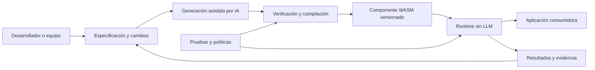

> Idioma del proyecto: **español**. Escribe este conocimiento en español. Mantén en inglés el código, los nombres de archivo, los comandos y las claves de configuración.

# Business Context

## Problem

El desarrollo de software asistido por IA ha simplificado la producción de código, pero sigue siendo difícil transformar requisitos expresados en lenguaje natural en **componentes ejecutables, verificables, portables y seguros**, especialmente cuando las reglas cambian y deben conservarse las garantías funcionales de versiones anteriores.

Un LLM puede escribir una implementación, pero esa salida no constituye por sí misma un contrato ejecutable: el resultado puede depender del lenguaje, del framework y del entorno de despliegue; también puede desviarse de los requisitos, incorporar dependencias no deseadas o generar código cuya ejecución y permisos sean difíciles de controlar. Consultar un LLM en cada operación de negocio añade latencia, costo y variabilidad, aunque en muchos casos la decisión podría ejecutarse de forma determinista.

**Agent-Native** busca resolver la distancia entre *intención funcional* y *software ejecutable*: transformar especificaciones y cambios incrementales en componentes WebAssembly verificables, ejecutables sin IA en tiempo de operación, con interfaces explícitas y controles de ejecución. No pretende reemplazar todos los lenguajes de programación ni afirmar que WASM siempre supera al código nativo en rendimiento.

El antecedente es la POC del repositorio [`Trycatch-tv/poc-agent-native`](https://github.com/Trycatch-tv/poc-agent-native), cuya Release Candidate v0.1.0 validó, dentro del alcance de Semantic IR v0.5, un flujo desde narrativa y Work Items hasta generación con LLM, verificación, compilación, composición WIT, ejecución en Wasmtime y evolución versionada. **Esa validación pertenece a la POC; no implica que las mismas capacidades ya estén disponibles en el nuevo repositorio.**

## Users

**Usuarios principales**

- **Desarrolladores y equipos de ingeniería:** necesitan expresar reglas funcionales, generar componentes reutilizables, ejecutar pruebas y evolucionar implementaciones sin rehacer manualmente toda la lógica.
- **Arquitectos de software y líderes técnicos:** necesitan definir contratos, límites de responsabilidades, decisiones técnicas, políticas de seguridad y criterios de calidad para sistemas que incorporan generación mediante IA.
- **Equipos de plataforma y DevOps:** necesitan distribuir, ejecutar, supervisar y controlar componentes en distintos entornos, sin requerir un LLM ni el compilador en producción.
- **Desarrolladores de herramientas y productos:** necesitan incorporar módulos funcionales generados o compilados a WASM en aplicaciones backend, CLI, desktop o web a través de adaptadores compatibles.

**Usuarios secundarios**

- **Analistas de negocio y product owners**, trabajando con equipos técnicos, que necesitan expresar comportamientos esperados y validar resultados mediante criterios de aceptación; no se presupone que puedan publicar software en producción sin revisión.
- **Contribuidores open source e investigadores**, interesados en generación de software, Semantic IR, WebAssembly Component Model e interoperabilidad entre lenguajes.

## Business goals

1. **Reducir la fricción entre requisitos y ejecución.** Establecer un flujo trazable de especificación → implementación → verificación → componente ejecutable, distinguiendo generación probabilística de validación determinista.
2. **Facilitar la evolución segura de funcionalidades.** Permitir introducir requisitos incrementales y generar nuevas versiones sin perder el historial, los contratos ni la evidencia de regresión.
3. **Promover portabilidad e interoperabilidad.** Utilizar WebAssembly y WIT para separar la lógica funcional del lenguaje de origen y del host de ejecución, dentro de las capacidades efectivamente soportadas por cada toolchain.
4. **Separar costo de construcción y costo de operación.** Usar IA durante la generación cuando aporte valor, mientras que las evaluaciones posteriores se ejecutan localmente sin llamadas obligatorias a modelos.
5. **Habilitar ejecución controlada.** Evolucionar hacia políticas explícitas de acceso a I/O, presupuestos de CPU y memoria, aislamiento entre instancias, y controles de publicación y procedencia de artefactos.
6. **Construir un proyecto open source independiente.** Desarrollar y documentar Agent-Native en [`Kaddo-kdd/agent-native`](https://github.com/Kaddo-kdd/agent-native) bajo la licencia MIT existente, con una experiencia reproducible y una arquitectura que no dependa de Kaddo para funcionar.
7. **Tomar decisiones basadas en evidencia.** Medir corrección, compatibilidad, tiempos de compilación, latencia de arranque, throughput, consumo de memoria y comportamiento bajo carga; evitar promesas de rendimiento sin benchmarks comparables.

**Indicadores de éxito del producto (a instrumentar, no resultados actuales):** porcentaje de pruebas de aceptación aprobadas, regresiones detectadas antes de publicación, reproducibilidad de artefactos, tiempo de generación, costo de inferencia, tiempo de arranque del runtime, latencias p50/p95/p99, throughput, memoria por instancia y errores por límites de seguridad. Las metas numéricas se establecerán tras disponer de una línea base reproducible.

## Constraints

**Separación de productos y fuentes.** Agent-Native es un producto autónomo. Kaddo gestionará inicialmente el conocimiento, la arquitectura y los Work Items **del desarrollo de Agent-Native**, pero no será una dependencia obligatoria de su compilador, runtime o CLI. Los Work Items de Kaddo no deben confundirse con los cambios funcionales que un usuario final suministre a Agent-Native. Una eventual integración entre ambos será opcional y posterior.

**Migración basada en evidencia.** La POC es referencia técnica, no código de producción automáticamente aprobado. Sus garantías deberán reproducirse en el nuevo repositorio. No se copiarán sin evaluación las implementaciones experimentales ni los supuestos específicos de los dominios usados en las pruebas.

**Seguridad y confianza.** Los componentes generados se tratarán como código no confiable. El modelo previsto será de privilegio mínimo: operaciones del host explícitamente registradas y autorizadas, validación de contratos, límites de recursos y mecanismos de verificación de integridad/procedencia. Un WASM válido no garantiza que la regla de negocio sea correcta; las decisiones de alto impacto requieren pruebas y revisión humana. Los controles adicionales son requisitos del producto, no capacidades que se presuman existentes.

**Compatibilidad y alcance técnico.** El motor debe operar dentro de versiones documentadas de Semantic IR, WIT, WebAssembly Component Model y WASI. No se garantiza la conversión automática de cualquier librería o característica de cualquier lenguaje a WASM. Tampoco se asume que todas las capacidades de WASI o de concurrencia estén disponibles desde la primera entrega.

**Portabilidad operativa.** La ejecución de un componente previamente compilado no debe exigir instalar Cargo/Rust ni disponer de un LLM. El uso de Rust y Wasmtime como base de implementación no implica dependencia de Rust para el consumidor final. Las plataformas y formatos de distribución soportados se definirán y validarán explícitamente.

**Gobierno de cambios.** Construcción incremental mediante Kaddo: conocimiento, arquitectura, refinamiento de WI, revisión humana, implementación, evidencia, verificación y aprendizaje. No se realizarán commits ni push automáticos sin revisión local y autorización explícita durante la etapa de construcción definida para este proyecto.

**Sostenibilidad.** Priorizar mantenibilidad, pruebas y documentación sobre la expansión prematura hacia generación de interfaces completas, múltiples runtimes, concurrencia avanzada o integraciones empresariales. El proyecto inicia como software open source; no se ha definido un modelo comercial ni metas de ingresos.

## Diagrams

El diagrama representa el modelo de valor objetivo. La generación, validación, compilación y ejecución cuentan con antecedente en la POC; la distribución como producto, las políticas operativas completas y las integraciones generales son parte del desarrollo pendiente.
