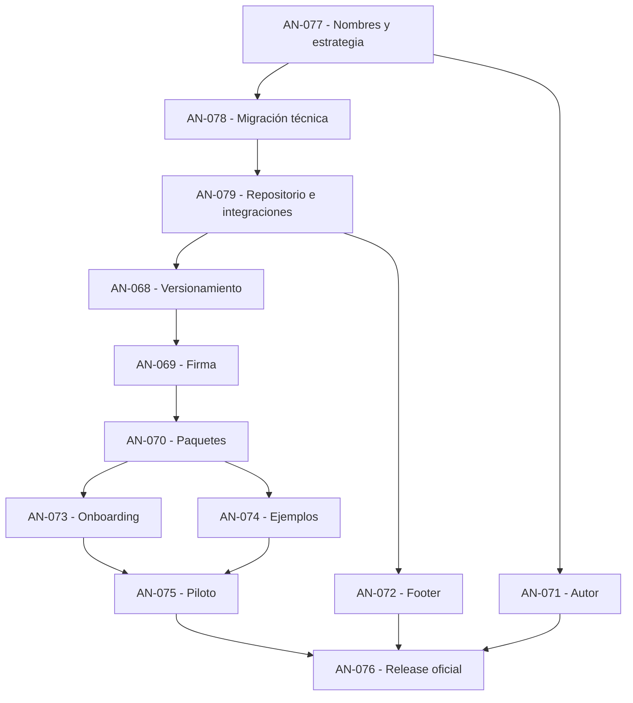

# INI-009 — Public Release, Technical Identity & Developer Adoption

**Tipo:** Iniciativa de producto y adopción  
**Estado propuesto:** Draft  
**Prioridad:** Alta  
**Dependencias:** INI-001 a INI-008 completadas  
**Producto:** Wasma / Agent Native  
**Hito objetivo:** Primera versión pública v0.1.0  
**Repositorio actual:** `Kaddo-kdd/agent-native`  
**Base de referencia:** commit `403e9fd` / `main`

## 1. Contexto y oportunidad

El núcleo técnico de Agent Native completó sus primeras ocho iniciativas y 67 Work Items. La identidad comercial del producto ya es Wasma, con presencia pública en `wasma.org`, pero la identidad técnica continúa utilizando nombres `agent-native`.

Actualmente existen discrepancias entre:

- Marca pública: Wasma (`wasma.org`).
- Binario CLI: `agent-native`.
- Paquete CLI de Cargo: `agent-native`.
- Crates de biblioteca: `agent-native-ir`, `agent-native-compiler` y `agent-native-runtime`.
- Repositorio GitHub: `Kaddo-kdd/agent-native`.
- Workspace Rust: versión `0.0.0`.
- Sitio web: versión independiente `0.1.0`.

La primera release oficial v0.1.0 es el momento oportuno para consolidar la identidad técnica del producto, antes de que usuarios externos empiecen a depender de comandos, nombres de paquetes y rutas definitivas.

No se debe realizar una sustitución indiscriminada de textos. La migración tiene que conservar las decisiones arquitectónicas, interfaces, garantías de seguridad y evidencia histórica existentes.

**Hipótesis de la iniciativa:** si Wasma consolida una identidad técnica coherente, dispone de una distribución confiable, una experiencia de aprendizaje sencilla y ejemplos prácticos reproducibles, los desarrolladores podrán evaluar sus capacidades sin necesitar asistencia directa del autor.

## 2. Nuevo objetivo general

Publicar la primera versión pública de Wasma bajo una identidad técnica coherente, con distribución verificable, documentación accesible y evidencia de utilización por desarrolladores externos.

La iniciativa se organiza en cinco líneas de trabajo:

1. **Identidad y migración técnica:** consolidar el nombre Wasma en las interfaces públicas, resolver conflictos y preservar compatibilidad.
2. **Release y distribución:** establecer versionamiento, firma, empaquetado y publicación controlada.
3. **Developer Experience:** simplificar instalación, aprendizaje y primeros casos de uso.
4. **Portal e identidad editorial:** presentar el autor y exponer la versión exacta del sitio desplegado.
5. **Validación externa:** comprobar la experiencia de desarrolladores y definir las siguientes prioridades a partir de evidencia.

La versión `v0.1.0` es el objetivo propuesto, pero su publicación queda condicionada a la revisión de nombres, seguridad de distribución y aceptación humana.

---

## 3. Alcance de las líneas de trabajo

### Línea 1 — Identidad técnica y migración de Wasma

Consolidar la identidad técnica mediante una secuencia ordenada:

- **AN-077 (Spike P0):** Inventario de referencias técnicas a `agent-native`, análisis de disponibilidad y colisiones en registros (`crates.io`, GitHub), evaluación de riesgos y definición formal de nombres objetivos y estrategia de migración/alias transitorios.
- **AN-078 (Feature P0):** Implementación técnica consistente en manifests Cargo (`Cargo.toml`), lockfile, ejecutable binario, rutas `use`, suites de tests y workflows de CI, preservando contratos Semantic IR y WIT.
- **AN-079 (Chore P0):** Planificación y ejecución auditada del renombramiento del repositorio GitHub `Kaddo-kdd/agent-native`, verificando redirecciones, CI/CD, webhooks y la integración del despliegue del portal `wasma.org`.

### Línea 2 — Release y distribución v0.1.0

La primera versión pública debe ser una entrega reproducible y verificable:

- **AN-068 (Chore P0):** Auditoría de release, contrato de versionamiento SemVer unificando paquetes a `0.1.0` (preservando versionamiento independiente de Semantic IR y WIT) y estructuración del `CHANGELOG.md` base.
- **AN-069 (Feature P0):** Pipeline de firma con catálogo SHA-256 y firma Minisign con clave oficial protegida en GitHub Secrets y verificación de nombres definitivos.
- **AN-070 (Feature P0):** Empaquetado multiplataforma (.tar.gz / .zip) para Linux x86_64 GNU, Windows x86_64 MSVC y macOS ARM64, con smoke tests del comando definitivo `wasma`.
- **AN-076 (Chore P0):** Publicación formal en GitHub Releases tras aprobación humana y validación integral.

### Línea 3 — Developer Experience y Onboarding

Facilitar el recorrido completo del desarrollador:

- **AN-073 (Docs P0):** Guía de inicio rápido (5 minutos) orientada al consumo del binario precompilado y la CLI definitiva, reconciliando la documentación del portal.
- **AN-074 (Feature P1):** Dos aplicaciones de referencia reproducibles en `examples/` (motor de reglas de negocio deterministas e integración host embebida) bajo la identidad Wasma.

### Línea 4 — Portal e identidad editorial

Fortalecer la confianza y transparencia en `wasma.org`:

- **AN-071 (Feature P1):** Sección «Sobre el autor» en la landing page principal con información profesional, motivación y origen del proyecto Wasma y su relación histórica con Agent Native.
- **AN-072 (Feature P1):** Metadatos automáticos en el footer (versión web, SHA corto de commit enlazado al repositorio canónico definitivo tras AN-079), distinguiendo formalmente versión web de CLI.

### Línea 5 — Validación externa

Comprobación empírica con usuarios reales:

- **AN-075 (Spike P1):** Prueba piloto con 5 a 10 desarrolladores externos para medir facilidad de localización, instalación, uso del comando `wasma`, comprensión del tutorial y recopilación de reporte de fricciones.

---

## 4. Work Items de la iniciativa (12 WIs)

| ID | Work Item | Tipo | Prioridad | Dependencias |
|---|---|---|---|---|
| **AN-077** | Evaluación de identidad técnica, disponibilidad de nombres y estrategia de migración | spike | P0 | — |
| **AN-078** | Migración técnica de Agent Native a Wasma | feature | P0 | AN-077 |
| **AN-079** | Migración de repositorio GitHub y continuidad de integraciones | chore | P0 | AN-078 |
| **AN-068** | Auditoría de preparación de release y contrato de versionamiento | chore | P0 | AN-078, AN-079 |
| **AN-069** | Firma oficial, integridad y controles del pipeline de publicación | feature | P0 | AN-068 |
| **AN-070** | Empaquetado, instalación y prerelease multiplataforma | feature | P0 | AN-069 |
| **AN-071** | Sección de autor e identidad editorial del proyecto | feature | P1 | AN-077 |
| **AN-072** | Versión, commit y procedencia del despliegue en el footer | feature | P1 | AN-079 |
| **AN-073** | Onboarding, quickstart y reconciliación de documentación | docs | P0 | AN-068, AN-070 |
| **AN-074** | Aplicaciones de referencia y pruebas E2E | feature | P1 | AN-070 |
| **AN-075** | Validación con desarrolladores externos y reporte de fricciones | spike | P1 | AN-073, AN-074 |
| **AN-076** | Publicación oficial v0.1.0 y cierre de INI-009 | chore | P0 | AN-069, AN-070, AN-071, AN-072, AN-073, AN-075 |

---

## 5. Dependencias y estrategia de ejecución

El orden de los identificadores numéricos no define la secuencia de ejecución. La iniciativa se estructura en cuatro fases estrictamente acíclicas:

### Fase 0 — Consolidación de identidad técnica

**Secuencia:** AN-077 → AN-078 → AN-079.  
**Puerta de salida:** Identidad técnica aprobada, migración en workspace Rust validada sin regresiones y repositorio GitHub e integraciones operativas.

### Fase 1 — Preparación y transparencia

**Secuencia:** AN-068, AN-071 y AN-072.  
**Puerta de salida:** Versión objetivo `0.1.0` y changelog consistentes en paquetes definitivos, sección del autor validada y metadatos del despliegue verificables en footer. (AN-071 puede avanzar en paralelo tras AN-077; AN-072 tras AN-079).

### Fase 2 — Distribución y experiencia inicial

**Secuencia:** AN-069 → AN-070 → AN-073 / AN-074.  
**Puerta de salida:** Release candidata instalable en 3 plataformas, firma Minisign verificable, documentación de onboarding y dos ejemplos de referencia funcionales.

### Fase 3 — Validación y publicación

**Secuencia:** AN-075 → AN-076.  
**Puerta de salida:** Piloto con desarrolladores externos completado, reporte de fricciones analizado, defectos bloqueantes resueltos, autorización humana explícita y release oficial v0.1.0 publicada.

---

## 6. Métricas de éxito

| Dimensión | Indicador | Evidencia |
|---|---|---|
| Identidad técnica | Cero colisiones y resolución limpia de nombres y dependencias | Matriz AN-077 y compilación AN-078 |
| Integraciones | Continuidad operativa de GitHub Actions, hosting y despliegues | Logs CI y comprobación de URLs tras AN-079 |
| Distribución | Instalación satisfactoria en las 3 plataformas objetivo | Pruebas desde paquetes publicados |
| Seguridad | Hashes SHA-256 y firma Minisign oficial verificables | Artefactos y CI de release |
| Developer Experience | Tiempo hasta el primer componente ejecutado con `wasma` | Sesiones piloto |
| Autonomía | Proporción de participantes que completan el tutorial sin ayuda | Observación y registro en AN-075 |
| Calidad documental | Ausencia de rutas o nombres obsoletos en guías públicas | Issues y pruebas de documentación |
| Casos prácticos | Dos aplicaciones de referencia reproducibles | Repositorio, tests y tutoriales |
| Transparencia web | Versión y SHA del deploy coinciden con el commit de producción | Validación del footer en sitio desplegado |
| Adopción inicial | Participación y feedback de desarrolladores externos | Reporte piloto |

---

## 7. Condiciones de cierre de INI-009

INI-009 podrá cerrarse formalmente cuando:

1. La identidad técnica definitiva esté aprobada y sin conflictos conocidos que bloqueen su distribución.
2. La migración de CLI, crates, scripts, CI y documentación esté implementada y validada sin regresiones en Semantic IR, WIT ni contratos de aislamiento.
3. Se haya verificado la continuidad de GitHub y de las integraciones del portal `wasma.org` tras el cambio de nombre.
4. La trazabilidad histórica permanezca preservada en Kaddo, Git y evidencia experimental de benchmarks.
5. Los paquetes binarios oficiales v0.1.0 para las 3 plataformas hayan sido publicados con autorización humana explícita, hashes y firmas Minisign verificables.
6. La instalación y el recorrido inicial funcionen desde los paquetes distribuidos utilizando los comandos definitivos.
7. Los dos ejemplos de referencia estén documentados y probados.
8. El portal muestre la sección del autor y los metadatos exactos de la versión web desplegada en el footer.
9. La prueba piloto haya producido evidencia de uso, reporte de fricciones y decisiones de mejora.
10. Se hayan documentado los límites conocidos y compatibilidad declarada, sin afirmar certificación universal para producción.

## 8. Fuera del alcance

- Certificación general para producción de misión crítica (v0.1.0 es una release de adopción y evaluación).
- Nuevos tipos de Semantic IR o features arquitectónicas adicionales no contempladas en las 8 iniciativas previas.
- Servicio HTTP persistente en el runtime.
- Multi-tenancy gestionado como servicio cloud.
- Reescritura del historial Git previo ni de los identificadores de Work Items completados AN-001..AN-067.
