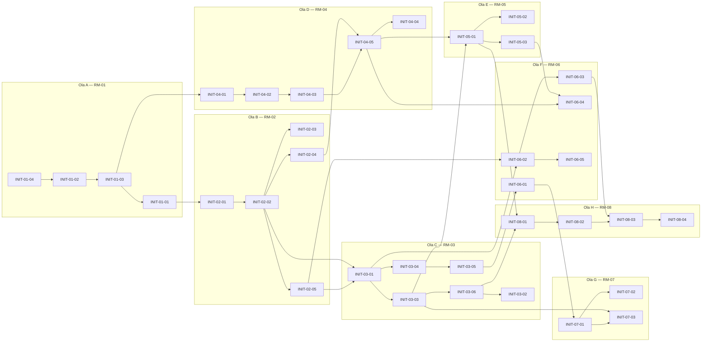

# Roadmap — Agent-Native

Generado con Kaddo Roadmap Agent. Las iniciativas y Work Items son **candidatos** para revisión humana — no son compromisos finales. Idioma del proyecto: español. Mantener en inglés el código, los nombres de archivo, los comandos y las claves de configuración.

## Summary

El roadmap organiza la construcción de Agent-Native en ocho bloques (**RM-01..RM-08**) que llevan al producto desde el repositorio vacío actual hasta un runtime caracterizado por benchmarks reproducibles. La construcción es incremental: cada incremento recupera primero una capacidad verificada por la POC, la aísla con fronteras limpias, le añade los controles mínimos de seguridad desde el inicio y solo entonces introduce evolución.

El norte funcional del MVP es: al cierre de **RM-05**, un desarrollador en una máquina sin Rust ni acceso a LLM puede instalar la CLI, descargar un componente publicado, ejecutarlo con suite de aceptación y recibir un resultado determinista o un fallo explícito. **RM-06** a **RM-08** llevan ese núcleo a condiciones de producción (seguridad profunda, I/O autorizada y rendimiento medido).

Fuentes:
- `knowledge/business/business.md`
- `knowledge/product/{product,capabilities}.md`
- `knowledge/tech/{codebase,current-state}.md`
- `knowledge/tech/discovery/{architecture-notes,decision-candidates}.md`
- `_reference/poc-agent-native/@26b6a18` (lectura histórica)

## Assumptions

- **A1 (inicial, no definitiva):** el workspace arranca con `crates/{ir,compiler,runtime}` + `crates/cli` (bin). La extracción de un crate `orchestrator`/`specification` se evalúa en RM-04 cuando las APIs de IR y runtime estén estables. El `compiler` queda limitado a IR → WASM: narrativa, LLM, publicación y evolución no viven en él.
- **A3 (objetivo, no decisión técnica cerrada):** las plataformas objetivo del primer release son `x86_64-unknown-linux-gnu`, `x86_64-pc-windows-msvc` y `aarch64-apple-darwin`. Empaquetado, firma, publicación y verificación se formalizan vía ADR en RM-05 y se materializan en INIT-05-03.
- **Equivalencia funcional primero:** no se incorporan nuevas características de Semantic IR antes de alcanzar equivalencia con la POC, salvo correcciones necesarias para compatibilidad, seguridad o integridad.
- **Independencia del runtime:** el runtime no depende del LLM, del compiler ni de Kaddo, y debe diseñarse de forma que no dependa del **origen** de los componentes ni exija que hayan sido generados mediante Semantic IR (interoperabilidad WIT como objetivo arquitectónico diferido).

> El supuesto previo sobre allocator/estrategia de memoria (dlmalloc + copia al host + reset entre tenants) fue **retirado**. Volvió a `[open]` en `codebase.md`. El plan de resolución es INIT-02-05 (modelo de memoria y Canonical ABI) + ADR-005.

## Roadmap Principles

1. **Recuperar antes de innovar.** Cada capacidad validada en la POC se extrae y vuelve a verificarse en el nuevo repositorio antes de ampliarla.
2. **Seguridad transversal, no una fase.** Los controles mínimos (fail-explicit en imports no autorizados, verificación SHA-256, deny-by-default) existen desde RM-02/RM-03. RM-06 los endurece, no los inaugura.
3. **El runtime nunca depende del LLM.** Esto se audita en cada entregable que toque `crates/runtime`.
4. **Fail-explicit sobre fallback silencioso.** Ningún camino de código produce `0`/`false` ante dependencia faltante o permiso denegado.
5. **Mediciones antes que optimización.** Caché, warm pool y concurrencia requieren línea base previa (INIT-03-06).
6. **Separación de responsabilidades.** `compiler` solo valida IR y emite WASM. Publicación atómica + versionamiento vive en la capa de orquestación. Narrativa e integración LLM viven en especificación.
7. **Interoperabilidad abierta como objetivo arquitectónico.** El runtime debe poder cargar componentes WIT-compatibles independientes de su origen; no se diseña un runtime cerrado.
8. **Candidatos, no compromisos.** Iniciativas, Work Items y releases son propuesta. Las fechas se fijan después de aprobación.

## Executive View

| ID | Bloque / Iniciativa | Prioridad | Dependencias | Resultado esperado | Estado |
|---|---|---|---|---|---|
| **RM-01** | **Foundation & POC Assessment** | — | — | Baseline arquitectónico aprobado | — |
| INIT-01-04 | Gobierno de `_reference/` y `.gitignore` | high | — | POC excluida de build, lectura preservada | propuesto |
| INIT-01-02 | Matriz de extracción POC → productos | high | INIT-01-04 | Mapa fuente→destino aprobado | parcial |
| INIT-01-03 | ADRs bloqueantes (001..005) | high | INIT-01-02 | 5 ADRs materializados | propuesto |
| INIT-01-01 | Workspace Rust y CI mínima | high | INIT-01-03 | Workspace compila; `fmt/clippy/test` verdes 3 OS | propuesto |
| **RM-02** | **Semantic IR & Compiler Extraction** | — | — | Compilador autónomo | — |
| INIT-02-01 | Crate `ir`: modelo + verifier v0.5 | high | INIT-01-01, INIT-01-03 | 8 pruebas `irtool` POC reproducidas | parcial (POC) |
| INIT-02-02 | Crate `compiler`: IR → WASM Component | high | INIT-02-01 | WASM determinista + hash SHA-256 | parcial (POC) |
| INIT-02-03 | Contratos WIT públicos vs internos | medium | INIT-02-02 | Separación `public/`/`internal/`/`fixtures/` en `wit/` | propuesto |
| INIT-02-04 | Determinismo + verificación de integridad | high | INIT-02-02 | Mismo input → mismo hash 3 OS; SHA-256 verificable | propuesto |
| INIT-02-05 | Modelo de memoria y Canonical ABI | high | INIT-02-02 | Documento + experimentos + ADR-005 cerrado | propuesto |
| **RM-03** | **Runtime & Acceptance Extraction** | — | — | Runtime autónomo con cobertura regresiva documentada + línea base de latencia | **M3 alcanzado 2026-10-19** bajo 7 criterios reformulados; ver INI-003 |
| INIT-03-01 | Crate `runtime`: carga + ejecución Wasmtime | high | INIT-02-02, INIT-02-05 | Componentes Core WASM y CM (alcance soportado) ejecutan sin compiler ni LLM | completed (AN-009, AN-014) |
| INIT-03-03 | Executor de aceptación YAML | high | INIT-03-01 | **completed 2026-10-19** (AN-019 + AN-020). Entrega: executor Core+CM dentro del alcance soportado, matriz POC 0+6+4, contrato YAML normativo. **Reinterpretado por decisión humana D1**: no se afirma reproducción literal de las 10 pruebas `runner` del POC. | AN-019 + AN-020 |
| INIT-03-04 | Propagación de errores host + imports | high | INIT-03-01 | Imports no autorizados y tipos no soportados producen error tipado fail-explicit sin fallback | completed (AN-010, AN-015) |
| INIT-03-05 | Controles mínimos de ejecución (deny-by-default) | high | INIT-03-04 | Deny-by-default pre-instantiate a 3 niveles verificado. **Decisión D2:** validación manifest-driven al cargar diferida a INIT-06-01 | completed (AN-011, AN-015) |
| INIT-03-06 | Línea base técnica del runtime | medium | INIT-03-03 | Línea base de latencia publicada (cold/warm/cache-hit). **Decisión D3:** memoria por instancia diferida a INIT-06-02 | completed (AN-012, AN-017) |
| INIT-03-02 | Resolver de dependencias reutilizable | medium | INIT-03-06 | Resolver cacheado con reset() implementado. Aislamiento multi-tenant avanzado e instancias diferido a INIT-06-03 | completed (AN-013) |
| **RM-04** | **Specification, Agents & Build Pipeline** | — | — | Pipeline generación + evolución integrado | — |
| INIT-04-01 | Intérprete narrativa Markdown → `SystemSpec` | medium | INIT-01-03 | Spec reproducible desde fixtures POC | parcial (POC) |
| INIT-04-02 | Adaptador LLM pluggable y modos de generación | medium | INIT-04-01, INIT-02-01 | Modos real / fixtures / synthesizer separados | parcial (POC) |
| INIT-04-03 | Evolución incremental de especificaciones | high | INIT-04-02 | Nuevo WI modifica regla; se preserva comportamiento acumulativo (v1→v2) | parcial (POC) |
| INIT-04-05 | Publicación atómica, versionamiento e integridad | high | INIT-02-04, INIT-04-03 | Manifiestos versionados, hash SHA-256, rollback atómico | parcial (POC) |
| INIT-04-04 | Trazabilidad artefacto ↔ Work Item / Spec | low | INIT-04-05 | Manifiesto incluye origen WI/Spec | nuevo |
| **RM-05** | **Standalone CLI & Runtime API** | — | — | Ejecución distribuible mediante CLI | **M5 alcanzado 2026-10-19**; ver INI-005 |
| INIT-05-01 | Bin `cli` con `build/verify/test/run/publish` | high | INIT-03-03, INIT-04-05 | CLI ejerce todas las APIs públicas | completed (AN-028) |
| INIT-05-02 | API pública reutilizable del runtime | medium | INIT-03-01 | SDK Rust embebible fuera del bin | completed (AN-029, AN-030) |
| INIT-05-03 | Pipeline de release para 3 triples objetivo | medium | INIT-05-01 | Artefactos distribuibles; firma/empaquetado via ADR dedicada | completed (AN-031, AN-032) |
| **RM-06** | **Runtime Security & Memory** | — | — | Runtime controlado por políticas | completed |
| INIT-06-01 | Policy loader de capabilities (manifest-driven) | high | INIT-03-05 | Allow-list por componente; deny por defecto | completed (AN-033, AN-034) |
| INIT-06-02 | Límites CPU/memoria (fuel + instance limits) | high | INIT-03-01, INIT-02-05 | Trap verificable al exceder presupuesto | completed (AN-035, AN-036, AN-037, AN-038) |
| INIT-06-03 | Ciclo de vida de instancias y aislamiento multi-tenant | medium | INIT-06-02, INIT-02-05 | Garantías de aislamiento antes de reutilizar instancias | completed (AN-039, AN-040) |
| INIT-06-04 | Verificación de integridad y procedencia en carga | medium | INIT-04-05, INIT-05-03 | `run --verify`: componente alterado falla | completed (AN-041, AN-042) |
| INIT-06-05 | Fixtures de ejecución extrema | medium | INIT-06-02 | Recursión controlada, allocación masiva, errores inducidos | completed (AN-043) |
| **RM-07** | **Console I/O & WASI** | — | — | Programas con I/O autorizada | completed |
| INIT-07-01 | Baseline WASI preview2 + stdio autorizado | medium | INIT-06-01 | Programa con I/O autorizada y aislamiento | completed (AN-044, AN-045) |
| INIT-07-02 | Extensión IR para `string` y errores | medium | INIT-02-01, INIT-04-05 | IR v0.6 bajo flag `--experimental`, sin romper v0.5 | completed (AN-048) |
| INIT-07-03 | Stubs deterministas de I/O para pruebas | low | INIT-07-01, INIT-03-03 | Suite YAML con `stdin` simulado | completed (AN-049) |
| **RM-08** | **Performance & Concurrency** | — | — | Runtime caracterizado por benchmarks | in-progress |
| INIT-08-01 | Harness de benchmarks reproducible | medium | INIT-03-06, INIT-05-01 | Varianza acotada entre corridas; cross-OS | completed (AN-051, AN-052) |
| INIT-08-02 | Línea base pública cross-OS | medium | INIT-08-01 | p50/p95/p99 publicados por operación | nuevo |
| INIT-08-03 | Caché de componentes y warm pool | medium | INIT-06-03, INIT-08-02 | Decisión controlada sobre caché/pool, con aislamiento demostrado | in-progress (AN-063/064 completed; no se adopta pool genérico) |
| INIT-08-04 | Concurrencia host-side (workers) | low | INIT-08-03 | Throughput escala con N workers hasta saturar | nuevo |
| **Diferido** | Interoperabilidad con componentes WIT externos | — | — | Objetivo arquitectónico; sin iniciativa activa | diferido |

Total: 8 bloques, 29 iniciativas activas y 1 objetivo diferido.

## Initiatives

### RM-01 — Foundation & POC Assessment

Convierte el repositorio vacío en una base verificable con decisiones registradas. Secuencia obligatoria: proteger la POC → consolidar matriz de extracción → materializar ADRs bloqueantes → construir el workspace sobre decisiones aprobadas.

#### INIT-01-04: Gobierno de `_reference/` y `.gitignore`

**Status:** candidate

**Priority:** high

**Suggested Knowledge Level:** K2

**Related domain:** Foundation & Governance

**Related capabilities:**
- (transversal)

**Source signals:**
- Risk: la POC indexada como código del producto introduce ambigüedad y riesgo de deriva
- Assumption: `_reference/poc-agent-native/` es solo lectura (codebase.md)

**Problem / opportunity:** Garantizar que la POC permanezca como fuente histórica consultable sin convertirse en dependencia del build o en código editable.

**Expected value:** Base inmutable para la matriz de extracción y las decisiones arquitectónicas.

**Risks:** indexadores (IDE, agentes) que ignoren el `.gitignore` y traten la POC como código del producto.

**Dependencies:** —

**Notes:** inicia la Ola A. Es prerrequisito explícito de todo lo demás.

**Suggested Work Items:**
- WI-CANDIDATE-01-04-01: ignorar `_reference/` en `.gitignore`
  - type: chore
  - suggested knowledge level: K1
  - expected value: build cerrado respecto a la POC
  - notes: validar con `git check-ignore -v _reference/poc-agent-native/Cargo.toml`
- WI-CANDIDATE-01-04-02: documentar política de solo lectura en `knowledge/tech/reference-policy.md`
  - type: chore
  - suggested knowledge level: K2
  - expected value: expectativa explícita para humanos y agentes
  - notes: incluir prohibición de commits y de imports como dependencia

**Not now:** hooks pre-commit para bloquear modificaciones en `_reference/` (opcional, posterior).

---

#### INIT-01-02: Matriz de extracción POC → productos

**Status:** candidate

**Priority:** high

**Suggested Knowledge Level:** K3

**Related domain:** Foundation & Governance

**Related capabilities:**
- (transversal — alimenta RM-02/03/04)

**Source signals:**
- Open Question (L154): qué artefactos POC se migran como fuente trazable
- Roadmap Candidate Signal: ordenar RM-02/03/04 depende de este mapa

**Problem / opportunity:** decidir, por cada pieza de la POC, si se **migra**, se **rediseña** o se **descarta**, con responsabilidades y pruebas asociadas.

**Expected value:** evita reutilización ciega de código experimental y ordena las olas B/C/D.

**Risks:** sobrestimar reutilización y heredar deuda; subestimarla y rehacer trabajo validado.

**Dependencies:** INIT-01-04 (lectura segura de `_reference/`).

**Notes:** entregable principal: `knowledge/tech/extraction-matrix.md`.

**Suggested Work Items:**
- WI-CANDIDATE-01-02-01: catálogo de pruebas POC por crate y responsabilidad
  - type: spike
  - suggested knowledge level: K3
- WI-CANDIDATE-01-02-02: redactar matriz de extracción final
  - type: chore
  - suggested knowledge level: K3

**Not now:** importar código ejecutable desde `_reference/`.

---

#### INIT-01-03: ADRs bloqueantes (001..005)

**Status:** candidate

**Priority:** high

**Suggested Knowledge Level:** K3

**Related domain:** Foundation & Governance

**Related capabilities:**
- (transversal)

**Source signals:**
- Tech Decision Candidate: todos los 10 candidatos en `knowledge/tech/discovery/decision-candidates.md` requieren materialización progresiva; estos 5 son bloqueantes para iniciar la construcción
- Open Questions (L143, L144, L145, L149) sostienen cada ADR

**Problem / opportunity:** materializar únicamente las decisiones estrictamente necesarias para no bloquear la construcción, sin congelar prematuramente lo que requiere evidencia.

**Expected value:** INIT-01-01 arranca sobre decisiones aprobadas.

**ADRs a materializar:**
- **ADR-001:** Arquitectura inicial y dependencias entre módulos; criterio para extraer `orchestrator`/`specification`.
- **ADR-002:** Runtime independiente del LLM y del compiler.
- **ADR-003:** Modelo de Semantic IR v0.5 y política de compatibilidad hacia v0.6.
- **ADR-004:** Estrategia de seguridad mínima transversal (fail-explicit, deny-by-default, SHA-256).
- **ADR-005:** Modelo de memoria y Canonical ABI, incluyendo liberación y ciclo de vida de instancias.

**Risks:** fijar baseline técnica (p. ej. versión exacta de Wasmtime) sin evidencia; mitigar manteniendo decisión abierta en ADR-003 hasta validación.

**Dependencies:** INIT-01-02.

**Notes:** los demás candidatos de `decision-candidates.md` se materializan cuando su bloque los demande.

**Suggested Work Items:**
- WI-CANDIDATE-01-03-01..05: un `chore` por ADR, con `knowledge level: K3`.

**Not now:** ADRs sobre distribución, publicación, resolver, caché, concurrencia (viven en sus bloques respectivos).

---

#### INIT-01-01: Workspace Rust y CI mínima

**Status:** candidate

**Priority:** high

**Suggested Knowledge Level:** K2

**Related domain:** Foundation & Governance

**Related capabilities:**
- (transversal — habilita RM-02 y siguientes)

**Source signals:**
- Assumption A1: 3 crates + bin `cli` como arranque
- Business Goal: proyecto open source reproducible

**Problem / opportunity:** materializar el workspace, el toolchain pinneado y una CI mínima sobre decisiones aprobadas.

**Expected value:** repositorio compilable y verificable en 3 OS, listo para recibir los crates reales.

**Risks:** elegir toolchain Rust incompatible con la baseline futura de Wasmtime.

**Dependencies:** INIT-01-03 (ADR-001 y ADR-003 aprobados).

**Notes:** inaugurar `rust-toolchain.toml` y GitHub Actions básicas.

**Suggested Work Items:**
- WI-CANDIDATE-01-01-01: inicializar workspace Cargo con crates `ir/compiler/runtime` + bin `cli`
  - type: chore
- WI-CANDIDATE-01-01-02: configurar GitHub Actions `fmt/clippy/test` en Linux/Windows/macOS
  - type: chore
- WI-CANDIDATE-01-01-03: pinear `rust-toolchain.toml`
  - type: chore

**Not now:** release pipeline (vive en INIT-05-03).

---

### RM-02 — Semantic IR & Compiler Extraction

Núcleo técnico "requisito → artefacto". Sin IR verificable y compilación determinista no hay producto.

#### INIT-02-01: Crate `ir` — modelo + verifier v0.5

**Status:** candidate

**Priority:** high

**Suggested Knowledge Level:** K3

**Related domain:** Semantic IR & Verification

**Related capabilities:**
- Semantic IR Verification (planned)

**Source signals:**
- POC evidence: `crates/irtool/src/lib.rs` con 8 pruebas de workspace
- Open Question L143/L144 (API pública y evolución IR)

**Problem / opportunity:** API estable y aislada de IR y verificador v0.5, sin depender del runtime ni del LLM.

**Expected value:** fundamento verificable para todo el pipeline.

**Risks:** fijar API pública prematuramente; mitigar con `pub(crate)` por defecto.

**Dependencies:** INIT-01-01, INIT-01-03.

**Notes:** criterio de salida ligado a las 8 pruebas `irtool`.

**Suggested Work Items:**
- WI-CANDIDATE-02-01-01: modelo IR v0.5 (`feature`)
- WI-CANDIDATE-02-01-02: verifier v0.5 (`feature`)
- WI-CANDIDATE-02-01-03: diagnósticos localizados (`feature`)
- WI-CANDIDATE-02-01-04: suite de regresión IR (`chore`)

**Not now:** extensiones `string`, streams, efectos — van a INIT-07-02.

---

#### INIT-02-02: Crate `compiler` — IR → WASM Component

**Status:** candidate · **Priority:** high · **K3**

**Related domain:** Compilation

**Related capabilities:** Component Compilation (planned)

**Source signals:** POC `crates/orchestrator/src/lib.rs` + `irtool`; ADR-001 limita el alcance del compiler.

**Problem / opportunity:** compilación determinista a WASM Component Model con contratos WIT, **sin** responsabilidades de publicación o de narrativa.

**Expected value:** `compile(ir) -> Artifact` reutilizable.

**Risks:** no-determinismo entre toolchains; acoplamiento con publicación (prohibido por ADR-001).

**Dependencies:** INIT-02-01.

**Notes:** la publicación atómica vive en INIT-04-05, no aquí.

**Suggested Work Items:**
- WI-CANDIDATE-02-02-01: backend WASM (`feature`)
- WI-CANDIDATE-02-02-02: generación de bindings WIT (`feature`)
- WI-CANDIDATE-02-02-03: auditoría de fronteras (lint CI: `compiler` no referencia store ni runtime) (`chore`)

**Not now:** store de artefactos, publicación, verificación de firma.

---

#### INIT-02-03: Contratos WIT públicos vs internos

**Status:** candidate · **Priority:** medium · **K2**

**Related domain:** Compilation

**Related capabilities:** Component Compilation

**Source signals:** Risk R-08 (fixture `kaddo:canal` como contrato implícito).

**Problem / opportunity:** reorganizar `wit/` en `public/`, `internal/` y `fixtures/` para evitar que fixtures de prueba se vuelvan contratos de dominio.

**Dependencies:** INIT-02-02.

**Suggested Work Items:**
- WI-CANDIDATE-02-03-01: estructura `wit/public|internal|fixtures/` (`chore`)
- WI-CANDIDATE-02-03-02: migrar fixture `kaddo:canal` a `tests/` (`chore`)

**Not now:** registro de componentes externos (objetivo arquitectónico diferido).

---

#### INIT-02-04: Determinismo + verificación de integridad

**Status:** candidate · **Priority:** high · **K3**

**Related domain:** Compilation

**Source signals:** ADR-004 (seguridad mínima transversal); OQ L145.

**Problem / opportunity:** garantizar que el pipeline IR→WASM es reproducible y verificable por hash.

**Expected value:** base para `agent-native run --verify` (INIT-06-04).

**Dependencies:** INIT-02-02.

**Suggested Work Items:**
- WI-CANDIDATE-02-04-01: harness de determinismo (`feature`)
- WI-CANDIDATE-02-04-02: cálculo canónico de SHA-256 por artefacto (`feature`)
- WI-CANDIDATE-02-04-03: pin de baseline Wasmtime en CI (`chore`) — depende de que ADR-003 cierre la selección

**Not now:** firma criptográfica (vive en RM-05/06).

---

#### INIT-02-05: Modelo de memoria y Canonical ABI

**Status:** candidate · **Priority:** high · **K4**

**Related domain:** Runtime & Memory

**Related capabilities:** Semantic IR Verification, Component Compilation, Independent Runtime Execution

**Source signals:** Risk R-11 (asignador incremental de la POC sin liberación general); OQ L148 (reabierta); ADR-005.

**Problem / opportunity:** documentar y validar cómo se gestionan asignación, liberación, crecimiento de memoria, Canonical ABI y ciclo de vida de instancias — reemplaza el supuesto retirado sobre dlmalloc.

**Expected value:** ADR-005 cerrado con sustento técnico y experimentos.

**Risks:** elegir estrategia prematura sin benchmark.

**Dependencies:** INIT-02-02.

**Suggested Work Items:**
- WI-CANDIDATE-02-05-01: catalogar comportamiento del allocator POC y sus límites (`spike`)
- WI-CANDIDATE-02-05-02: experimentos de retorno de registros bajo Canonical ABI (`spike`)
- WI-CANDIDATE-02-05-03: redactar ADR-005 (`chore`)

**Not now:** adopción de allocators alternativos (depende de medición en INIT-03-06).

---

### RM-03 — Runtime & Acceptance Extraction

Hace el runtime autónomo, con los controles mínimos de seguridad y una línea base técnica antes de cualquier optimización.

#### INIT-03-01: Crate `runtime` — carga + ejecución Wasmtime

**Status:** completed (AN-009, AN-014) · **Priority:** high · **K3**

**Related domain:** Runtime & Memory

**Related capabilities:** Independent Runtime Execution

**Source signals:** POC `crates/runner/src/main.rs`; ADR-002.

**Problem / opportunity:** API Rust que carga un artefacto publicado y ejecuta una función exportada vía WIT, sin dependencia del compiler ni del LLM. Debe permitir cargar componentes WIT-compatibles **independientes de su origen** (objetivo arquitectónico diferido).

**Dependencies:** INIT-02-02, INIT-02-05.

**Suggested Work Items:**
- WI-CANDIDATE-03-01-01: engine runtime + instancia (`feature`)
- WI-CANDIDATE-03-01-02: invocación tipada WIT (`feature`)
- WI-CANDIDATE-03-01-03: lint CI "runtime no depende de compiler" (`chore`)

**Not now:** fuel/instance limits (INIT-06-02); policy loader completo (INIT-06-01).

---

#### INIT-03-03: Executor de aceptación YAML

**Status:** **completed 2026-10-19** · **Priority:** high · **K3**

**Materialized as:** AN-019 (executor + stubs + regresión POC) + AN-020 (cierre técnico M3).

**Related domain:** Validation & Evolution

**Related capabilities:** Acceptance Testing & Regression

**Source signals:** POC `runner` (10 pruebas); dominio de esclusas (5+5) se valida de forma integral en INIT-04-03/04-05.

**Problem / opportunity:** correr suites declarativas (`entradas`, `esperado`, `host-mocks`) sin requerir LLM.

**Dependencies:** INIT-03-01.

**Notes:** criterio de salida de RM-03 **reformulado por decisión humana D1 (2026-10-19)**: la frase literal "10 pruebas `runner` POC verdes" se sustituye por cobertura regresiva documentada en matriz 1:1 con grados verificables. Resultado publicado: **0 `equivalencia-exacta` + 6 `cobertura-parcial` + 4 `aplazado`** (ver `knowledge/tech/poc-equivalence-matrix.md`). Las 5+5 de esclusas siguen atadas a INIT-04-03/INIT-04-05.

**Alcance soportado:** Core WASM + Component Model (CM) sin imports funcionales. CM con imports funcionales → RM-07.

**Fuera de alcance (post-M3):** stubs funcionales de Component Model, composición multi-componente, host providers reales, políticas manifest-driven al cargar, memoria por instancia, WASI, esclusas v1→v2 integrales, cadenas multi-paso de dependencias, propagación inmediata de errores desde callbacks del host.

**Materialized Work Items:**
- AN-019 — Executor + 7 submódulos + 3 kinds de stub + regresión POC inicial
- AN-020 — Cierre técnico M3: compat YAML POC, Component Model type-only, StateReader fail-contract (D1 opción A: supresión de efectos posteriores, sin trap inmediato del guest), matriz re-evaluada, contrato normativo publicado

---

#### INIT-03-04: Propagación de errores host + imports

**Status:** completed (AN-010, AN-015) · **Priority:** high · **K3**

**Related domain:** Runtime & Memory

**Source signals:** ADR-004; principio fail-explicit.

**Problem / opportunity:** errores tipados ante import no autorizado o capability faltante; nunca degradación a valores por defecto.

**Dependencies:** INIT-03-01.

**Notes:** gate obligatorio para INIT-05-01 (no se distribuye un runtime sin esto). Verificado por M3-CRIT-2 (fail-explicit en lifting sin fallback a 0).

**Suggested Work Items:**
- WI-CANDIDATE-03-04-01: enum `RuntimeError` (`feature`)
- WI-CANDIDATE-03-04-02: suite de pruebas negativas (`chore`)

---

#### INIT-03-05: Controles mínimos de ejecución (deny-by-default)

**Status:** completed (AN-011, AN-015) · **Priority:** high · **K3**

**Related domain:** Runtime & Memory, Security

**Source signals:** ADR-004; nuevo ajuste "seguridad desde el inicio".

**Problem / opportunity:** deny por defecto en capabilities del host desde el primer runtime ejecutable; sin esperar a RM-06.

**Expected value:** cualquier release pre-RM-06 no es vulnerable a imports no listados.

**Dependencies:** INIT-03-04.

**Notes:** criterio de salida reformulado por **decisión humana D2 (2026-10-19)**: el requisito original de validación manifest-driven en `load_component` se difirió formalmente a **INIT-06-01** (policy loader manifest-driven). Para M3, se verificó el control deny-by-default pre-instantiate a tres niveles (core, WIT interface, WIT operation) con fallo explícito (`RuntimeError::UnauthorizedImport`) antes de ejecutar guest code (M3-CRIT-3).

**Suggested Work Items:**
- WI-CANDIDATE-03-05-01: allow-list mínima en manifiesto (`feature`)
- WI-CANDIDATE-03-05-02: audit CI de capabilities por fixture (`chore`)

---

#### INIT-03-06: Línea base técnica del runtime

**Status:** completed (AN-012, AN-017) · **Priority:** medium · **K3**

**Related domain:** Runtime & Memory, Performance

**Source signals:** nuevo ajuste "benchmark inicial"; principio "mediciones antes que optimización".

**Problem / opportunity:** medición mínima de latencia (cold start, warm invocation, cache-hit) **antes** de cualquier caché o reutilización — insumo obligatorio de INIT-03-02 y RM-08.

**Dependencies:** INIT-03-03.

**Notes:** no es RM-08. Es una línea base mínima para no construir caché a ciegas. **Reformulado por decisión humana D3 (2026-10-19)**: la línea base de latencia (cold start, warm invocation, cache-hit) fue publicada en `knowledge/tech/baselines/runtime-baseline.md`. La **medición de memoria por instancia fue diferida formalmente a INIT-06-02** (fuel + instance limits + `ResourceLimiter`), por lo que no constituye una obligación pendiente de M3.

**Suggested Work Items:**
- WI-CANDIDATE-03-06-01: micro-bench cold start (`chore`)
- WI-CANDIDATE-03-06-02: micro-bench warm invocation (`chore`)
- WI-CANDIDATE-03-06-03: medición de memoria por instancia (`chore` — diferido a INIT-06-02 por decisión D3)

---

#### INIT-03-02: Resolver de dependencias reutilizable

**Status:** completed (AN-013) · **Priority:** medium · **K3**

**Related domain:** Runtime & Memory

**Source signals:** OQ L147 (recompilación por invocación en la POC).

**Problem / opportunity:** eliminar compilación/instanciación repetida de dependencias mediante caché content-addressed con capacidad de limpieza por sesión/tenant.

**Dependencies:** INIT-03-06 (requiere línea base previa).

**Notes:** materializado como resolver content-addressed de componentes (`Resolver`) en `crates/runtime/src/resolver.rs` (AN-013). La función `Resolver::reset()` ya está implementada y limpia activamente la caché de artefactos (`self.cache.clear()`). La gestión avanzada de aislamiento multi-tenant y ciclo de vida de instancias persistentes continúa formalmente diferida a **INIT-06-03**.

**Suggested Work Items:**
- WI-CANDIDATE-03-02-01: resolver cacheado por sesión (`feature` — materializado en AN-013)
- WI-CANDIDATE-03-02-02: `Resolver::reset()` para limpieza de caché (`feature` — materializado en AN-013; aislamiento avanzado de instancias diferido a INIT-06-03)

---

### RM-04 — Specification, Agents & Build Pipeline

Cierra el flujo "requisito → componente publicado". La publicación atómica vive aquí, no en el compiler.
**Cierre de Bloque (Decisión D1 - Opción A, 2026-10-19):** Completado a nivel de arquitectura, especificaciones, compilación y publicación. Las garantías de generación operan determinísticamente bajo `fixtures` y `synthesizer`. El modo `real` (`HttpLlmProvider`) permanece como stub de interfaz sin transporte HTTP activo en M4; su transporte y validación E2E se gestionan en un Work Item dedicado previo a cualquier distribución que anuncie IA.

#### INIT-04-01: Intérprete narrativa Markdown → `SystemSpec`

**Status:** **completed 2026-10-19** · **Priority:** medium · **K3**

**Materialized as:** AN-023

**Related domain:** Specification & Knowledge Ingestion

**Related capabilities:** Specification Interpretation

**Source signals:** POC `crates/orchestrator/src/interpreter.rs`; OQ L143.

**Dependencies:** INIT-01-03.

**Notes:** vive en la capa de orquestación (`crates/cli/src/spec/`). Parser de narrativa con frontmatter YAML, tipos, invariantes y escenarios de prueba que produce un `SystemSpec` canónico serializable.

---

#### INIT-04-02: Adaptador LLM pluggable y modos de generación

**Status:** **completed 2026-10-19** · **Priority:** medium · **K3**

**Materialized as:** AN-024

**Related domain:** Specification & Knowledge Ingestion, LLM-driven Implementation

**Related capabilities:** LLM-driven Implementation

**Source signals:** Risk R-12 (confundir offline con capacidad generativa); ADR-003.

**Problem / opportunity:** separar explícitamente tres modos:
- **real:** proveedor LLM (`HttpLlmProvider`), con validación de API key, endpoint y prompts estructurados con esquema v0.5. **En M4 no incluye transporte HTTP funcional** (falla explícitamente con `AgentError::Http` para entornos offline). No es una capacidad generativa verificada hasta contar con transporte real y pruebas E2E.
- **fixtures:** respuestas pregrabadas para regresión reproducible. **No equivalente** a generación real. (100% verificado en CI offline).
- **synthesizer:** sintetizador determinista basado en reglas para generación estructural sin red. **No equivalente** a generación real. (100% verificado en CI offline).

Los dos últimos **no deben presentarse** como la capacidad generativa del agente.

**Dependencies:** INIT-04-01, INIT-02-01.

**Follow-up Work Item:** WI-CANDIDATE-05-04 (transporte HTTP simulado + validación E2E opt-in del proveedor real antes de distribución pública con IA).

---

#### INIT-04-03: Evolución incremental de especificaciones

**Status:** **completed 2026-10-19** · **Priority:** high · **K4**

**Materialized as:** AN-025

**Related domain:** Specification & Knowledge Ingestion, Validation & Evolution

**Related capabilities:** Versioned Publication & Evolution (parte "evolución")

**Source signals:** POC — evolución v1→v2 del dominio esclusas; principio "comportamiento acumulativo".

**Problem / opportunity:** reconciliar un nuevo Work Item funcional con la versión anterior preservando el comportamiento acumulativo; detectar regresión antes de publicar.

**Expected value:** demostración de evolución reproducible v1→v2 (5+5 pruebas POC esclusas) mediante reconciliador monotónico de `SystemSpec` y cálculo exhaustivo de `SpecDiff`.

**Dependencies:** INIT-04-02.

---

#### INIT-04-05: Publicación atómica, versionamiento e integridad

**Status:** **completed 2026-10-19** · **Priority:** high · **K4**

**Materialized as:** AN-026

**Related domain:** Validation & Evolution, Distribution & DX

**Related capabilities:** Versioned Publication & Evolution (parte "publicación")

**Source signals:** ADR-001 (publicación fuera del compiler); POC — publicación atómica validada.

**Problem / opportunity:** store de artefactos (filesystem local en MVP, D-02 aprobado), manifiestos versionados, hash SHA-256, puntero activo (`active.json`), preservación de la versión anterior y rollback atómico ante fallos en staging.

**Expected value:** separación limpia compiler ↔ publicación; auditabilidad por manifiesto.

**Dependencies:** INIT-02-04 (hash determinista), INIT-04-03 (evolución integrada).

---

#### INIT-04-04: Trazabilidad artefacto ↔ Work Item / Spec

**Status:** **completed 2026-10-19** · **Priority:** low · **K2**

**Materialized as:** AN-027

**Related domain:** Validation & Evolution

**Source signals:** Business Goal — decisiones basadas en evidencia; principio de trazabilidad.

**Problem / opportunity:** campos `source_wi`, `source_spec_hash`, `source_git_commit` en el manifiesto permiten reconstruir origen determinista sin ejecutar Kaddo ni dependencias externas.

**Dependencies:** INIT-04-05.

---

### RM-05 — Standalone CLI & Runtime API

Convierte el pipeline interno en herramienta distribuible.
**Restricción de Identidad (Decisión D3, 2026-10-19):** Se mantiene temporalmente el nombre interno `agent-native` en crates, binarios y rutas internas. Queda congelada toda publicación en crates.io, release público con branding definitivo y cambios de nombres de paquetes hasta recibir decisión humana de identidad.

#### INIT-05-01: Bin `cli` con `build/verify/test/run/publish`

**Status:** **completed 2026-10-19** · **Priority:** high · **K3**

**Materialized as:** AN-028

**Related domain:** Distribution & DX

**Related capabilities:** CLI as Primary Interface

**Source signals:** ADR-001 (CLI sin lógica de dominio).

**Dependencies:** INIT-03-03, INIT-04-05.

**Notes:** interfaz basada en `clap`; lógica de dominio delegada a crates/módulos internos; soporte de salidas `--format=human` y `--format=json`; códigos de salida estandarizados y pruebas E2E desde procesos independientes.

**Suggested Work Items:**
- WI-CANDIDATE-05-01-01: parser `clap`, contratos de subcomandos y salidas estructuradas (`feature`, AN-028 — completado).

---

#### INIT-05-02: API pública reutilizable del runtime

**Status:** **completed 2026-10-19** · **Priority:** medium · **K3**

**Materialized as:** AN-029, AN-030

**Related domain:** Runtime & Memory, Distribution & DX

**Related capabilities:** Independent Runtime Execution (dimensión embeber)

**Source signals:** Objetivo arquitectónico — runtime embebible sin toolchain.

**Dependencies:** INIT-03-01. (Independiente de AN-028 per Decisión D5).

**Notes:** estabilizar las interfaces existentes (`Engine`, `Component`, `Val`, `RuntimeError`, `HostPolicy`) en `agent-native-runtime` sin crear tipos abstractos artificiales. AN-021 y AN-022 proveen evidencia de integración, y AN-029 junto con el ejemplo canónico `embed_runtime.rs` (AN-030) completan y verifican formalmente la iniciativa.

**Suggested Work Items:**
- WI-CANDIDATE-05-02-01: estabilización y curación de la API pública existente (`chore`, AN-029 — completado).
- WI-CANDIDATE-05-02-02: ejemplo canónico de consumo externo `examples/embed_runtime.rs` (`feature`, AN-030 — completado).

---

#### INIT-05-03: Pipeline de release para 3 triples objetivo

**Status:** **completed 2026-10-19** · **Priority:** medium · **K3**

**Materialized as:** AN-031, AN-032

**Related domain:** Distribution & DX

**Source signals:** A3 (objetivo); D-04 diferido hasta este bloque.

**Problem / opportunity:** empaquetado, firma, publicación y verificación formalizados vía ADR dedicada; compilación multi-target sin dependencias artificiales.

**Dependencies:** INIT-05-01 (binario CLI) e INIT-05-03-01 (ADR de firma).

**Notes:** La ADR de empaquetado y firma (ADR-006) y el pipeline GitHub Actions (`.github/workflows/release.yml`) automatizan la distribución para Linux x86_64, Windows x86_64 y macOS aarch64 con firma Minisign Ed25519 determinista offline.

**Suggested Work Items:**
- WI-CANDIDATE-05-03-01: ADR de empaquetado, firma y verificación (`chore`, AN-031 — completado, ADR-006).
- WI-CANDIDATE-05-03-02: pipeline multi-target CI (`chore`, AN-032 — completado).

---

#### INIT-05-04: Adaptador HTTP y validación E2E del proveedor LLM real

**Status:** candidate · **Priority:** medium · **K3**

**Related domain:** Specification & Knowledge Ingestion, LLM-driven Implementation

**Source signals:** Decisión humana D1 (cierre honesto M4, seguimiento de R-12).

**Problem / opportunity:** completar `HttpLlmProvider` con transporte HTTP simulado (cassettes/mocks) para CI offline y suite de validación E2E opt-in con secretos reales.

**Dependencies:** INIT-04-02.

**Suggested Work Items:**
- WI-CANDIDATE-05-04-01: cliente HTTP real, transporte mockeable y validación E2E opt-in (`feature`).

---

### RM-06 — Runtime Security & Memory

Profundiza seguridad y memoria sobre los controles mínimos ya existentes. **No** es el primer momento en que se consideran.

#### INIT-06-01: Policy loader de capabilities (manifest-driven)

**Status:** candidate · **Priority:** high · **K4**

**Related domain:** Runtime & Memory, Security

**Related capabilities:** Host Capability Policy

**Source signals:** OQ L149; evolución de INIT-03-05.

**Dependencies:** INIT-03-05.

**Notes:** recibe formalmente la validación manifest-driven de capabilities al cargar (`load_component`), diferida de M3 (INIT-03-05) por la decisión humana D2 (2026-10-19).

**Suggested Work Items:**
- WI-CANDIDATE-06-01-01: policy loader `Policy` (`feature`)
- WI-CANDIDATE-06-01-02: pruebas negativas por capability (`chore`)

---

#### INIT-06-02: Límites CPU/memoria (fuel + instance limits)

**Status:** **completed 2026-10-19** · **Priority:** high · **K4**

**Materialized as:** AN-035, AN-036, AN-037, AN-038 (completed)

**Source signals:** Risk R-11; ADR-005.

**Dependencies:** INIT-03-01, INIT-02-05.

**Notes:** AN-036 implementa contención de memoria lineal y tablas mediante `ResourceLimiter` (verificado en los escenarios cubiertos cross-OS). AN-037 provee suite negativa de estrés y Store isolation. AN-035 provee fuel accounting por Store. AN-038 resolvió la contención de bucles infinitos ante agotamiento de fuel en Windows MSVC mediante la promoción técnica a Wasmtime 29.0.1 (Bytecode Alliance PR #9710: *Migrate libcalls to checking for traps*), garantizando atrapado limpio de `FuelExhausted` sin terminación de proceso en todas las plataformas y eliminando todas las exclusiones `#[ignore]`. Se registra la deuda de mantenimiento para evaluar Wasmtime 49+/50+ en RM-08.

**Suggested Work Items:**
- WI-CANDIDATE-06-02-01: fuel accounting (`feature`, AN-035 — completed)
- WI-CANDIDATE-06-02-02: `InstanceLimits` configurables y `ResourceLimiter` (`feature`, AN-036 — completed)
- WI-CANDIDATE-06-02-03: suite de pruebas negativas y límites (`test`, AN-037 — completed)
- WI-CANDIDATE-06-02-05: contención segura de agotamiento de fuel en Windows MSVC (`chore`, AN-038 — completed)

---

#### INIT-06-03: Ciclo de vida de instancias y aislamiento multi-tenant

**Status:** **completed 2026-10-19** · **Priority:** medium · **K4**

**Materialized as:** AN-039, AN-040 (completed)

**Source signals:** Risk R-11; OQ L146.

**Problem / opportunity:** garantías de aislamiento verificables demostrando que un componente problemático no puede afectar a otro tenant. **Invariante obligatoria:** estrictamente sin reutilización de instancias entre tenants (Store fresco por invocación).

**Dependencies:** INIT-06-02, INIT-02-05.

**Notes:** incorpora la agregación de cuotas por tenant (más allá del límite por crecimiento de memoria lineal de una instancia individual de AN-036), unificación de rutas de invocación con host context (`invoke_*_with_host_ctx`) bajo los mismos límites, y refinamiento del diagnóstico de traps de memoria sin asumir falsos positivos correlacionados.

**Suggested Work Items:**
- WI-CANDIDATE-06-03-01: API `Tenant` y ciclo de vida de invocación (`feature`, AN-039 — completed)
- WI-CANDIDATE-06-03-02: tests de contaminación cruzada y contención de blast radius (`chore`/`test`, AN-040 — completed)

---

#### INIT-06-04: Verificación de integridad y procedencia en carga

**Status:** completed · **Priority:** medium · **K3**

**Source signals:** ADR-004; INIT-05-03 define el formato.

**Dependencies:** INIT-04-05, INIT-05-03.

**Work Items:**
- AN-041: `run --verify` (SHA-256) (`feature`) (completed)
- AN-042: verificación de firma criptográfica Minisign (`feature`) (completed)

---

#### INIT-06-05: Fixtures de ejecución extrema

**Status:** completed · **Priority:** medium · **K3**

**Source signals:** Risk R-13 (IR v0.5 sin bucles generales); nuevo ajuste "pruebas de límites".

**Problem / opportunity:** fixtures WASM específicos (recursión controlada, allocación masiva, errores inducidos) escritos a bajo nivel para probar fuel, memory limits y traps sin depender de IR v0.5.

**Dependencies:** INIT-06-02.

**Work Items:**
- AN-043: fixtures de ejecución extrema (recursión controlada, allocación masiva, trampas inducidas) (`test`) (completed)

---

### RM-07 — Console I/O & WASI

Habilita programas reales útiles sobre la base segura. No se adelanta a RM-06.

#### INIT-07-01: Baseline WASI preview2 + stdio autorizado

**Status:** completed · **Priority:** medium · **K3**

**Source signals:** OQ L152; capability `wasi:cli/stdio`.

**Dependencies:** INIT-06-01.

**Risks:** churn en preview2 — pinnear versión `wasmtime-wasi = "29.0.1"`.

**Work Items:**
- AN-044: adaptador WASI preview2 para I/O determinista en memoria (`feature`) (completed)
- AN-045: autorización granular de stdio y streams bajo Requested ∩ Granted (`feature`) (completed)
- AN-050: soporte de binarios reales `wasm32-wasip2` bajo deny-by-default (`feature`) (ready; ampliación posterior, no bloquea RM-08)

---

#### INIT-07-02: Extensión IR para `string` y errores

**Status:** completed · **Priority:** medium · **K4**

**Source signals:** OQ L144; "equivalencia funcional primero" — se activa solo tras M3.

**Problem / opportunity:** extender IR a v0.6 bajo flag `--experimental`, sin romper v0.5.

**Dependencies:** INIT-02-01, INIT-04-05.

**Notes:** una excepción al principio "no incorporar nuevas características antes de equivalencia POC"; esta extensión se justifica porque WASI preview2 requiere `string`. Permanece **experimental**.

**Work Items:**
- AN-048: extensión Semantic IR v0.6 para `string`, `result<T, E>` y política de versionamiento `--experimental` (`feature`) (completed)

---

#### INIT-07-03: Stubs deterministas de I/O para pruebas

**Status:** completed · **Priority:** low · **K2**

**Dependencies:** INIT-07-01, INIT-03-03.

**Work Items:**
- AN-049: stubs deterministas de I/O (`stdin`/`expected_stdout`/`expected_stderr`) y tipos v0.6 en el executor YAML (`feature`) (completed)

---

### RM-08 — Performance & Concurrency

Harness formal, benchmarks reproducibles cross-OS, caché/warm pool, concurrencia host-side. Toma la línea base de INIT-03-06 como entrada.

#### INIT-08-01: Harness de benchmarks reproducible

**Status:** completed · **Priority:** medium · **K3**

**Source signals:** Business Goal — decisiones basadas en evidencia. INIT-03-06 produjo la línea base local; AN-017 la consolidó con la convención `<stage>_<path>_<fixture>` y 9 benches en [`knowledge/tech/baselines/runtime-baseline.md`](../tech/baselines/runtime-baseline.md); este bloque la generaliza a matrix cross-OS.

**Dependencies:** INIT-03-06, INIT-05-01.

**Work Items:**
- AN-051: harness `criterion` extendido (WASI I/O, IR v0.6, fuel) y ficha de entorno (`feature`) (completed)
- AN-052: job manual de benchmarks cross-OS con artefactos (`chore`) (completed)

---

#### INIT-08-02: Línea base pública cross-OS

**Status:** candidate · **Priority:** medium · **K3**

**Dependencies:** INIT-08-01.

**Suggested Work Items:**
- WI-CANDIDATE-08-02-01: medir cold start cross-OS (`chore`)
- WI-CANDIDATE-08-02-02: medir warm invocation (`chore`)
- WI-CANDIDATE-08-02-03: publicar línea base en `docs/benchmarks/` (`chore`)

---

#### INIT-08-03: Caché de componentes y warm pool

**Status:** candidate · **Priority:** medium · **K4**

**Dependencies:** INIT-06-03, INIT-08-02.

**Notes:** el `Resolver` ya conserva caché content-addressed de artefactos; no
se duplica sin identificar un coste residual. INIT-08-02 sigue abierta, pero su
publicación aporta evidencia suficiente para diseñar un experimento controlado.
La adopción de una optimización depende de una A/A y comparación pareada en
Linux x86_64 GNU, no de una cifra cross-OS. Store fresco por invocación sigue
siendo la baseline de ADR-005; cualquier pool requiere aislamiento y descarte
seguro verificables.

**Diseño refinado:** `docs/benchmarks/init-08-03-experimental-design.md`.

**Suggested Work Items:**
- WI-CANDIDATE-08-03-01 / AN-063 completado: contrato de experimento, frontera
  temporal y pruebas de contaminación/aislamiento (`chore`).
- WI-CANDIDATE-08-03-02 / AN-064 completado sin adopción: caché o pool experimental acotado
  detrás de API/flag, solo tras AN-063 (`feature`).
- WI-CANDIDATE-08-03-03 / AN-065: no materializado; requiere primero un
  tratamiento seguro y verificable que comparar (`chore`).

---

#### INIT-08-04: Concurrencia host-side (workers)

**Status:** candidate · **Priority:** low · **K4**

**Dependencies propuestas (pendientes de aprobación):** INIT-06-03,
INIT-08-01 y AN-055. INIT-08-03 queda como antecedente de seguridad de no
reutilización, no como bloqueo: los workers conservan Store/instancia fresca.

**Propuesta:** `docs/benchmarks/init-08-03-08-04-architecture-proposal.md`.

**Suggested Work Items propuestos:**
- AN-065: contrato y prototipo experimental de workers acotados (`feature`).
- AN-066: aislamiento concurrente, backpressure y fallos (`chore`).
- AN-067: saturación, throughput y soak controlados (`chore`).

---

### Objetivo arquitectónico diferido — Interoperabilidad con componentes WIT-compatibles

**Status:** deferred

**Related domain:** Compilation, Runtime & Memory

**Related capabilities:** External Component Interop (futuro)

**Source signals:** nuevo ajuste "interoperabilidad conservada como objetivo"; `knowledge/product/capabilities.md`.

**Problem / opportunity:** el runtime debe poder cargar componentes WIT-compatibles **independientes de su origen**, no solo los generados por Agent-Native. No se diseña un runtime cerrado.

**Impacto en el roadmap activo:**
- ADR-001 debe permitirlo explícitamente.
- INIT-03-01 incluye como criterio no-funcional: cargar un componente WIT externo verificable.

**Trabajo pospuesto:** registro de componentes externos, resolución de dependencias WIT externas, política de compatibilidad y composición multi-origen. Se materializará como bloque adicional cuando exista demanda y evidencia; se mantiene registrado en `capabilities.md` y en `knowledge/tech/discovery/decision-candidates.md`.

## Suggested Execution Order

**Ola A — RM-01 (Foundation):**
1. INIT-01-04 → 2. INIT-01-02 → 3. INIT-01-03 → 4. INIT-01-01
**Hito M1:** baseline arquitectónico aprobado.

**Ola B — RM-02 (IR + compiler):**
INIT-02-01 → INIT-02-02 (paralelo con INIT-02-03) → INIT-02-04 e INIT-02-05.
**Hito M2:** compilador autónomo.

**Ola C — RM-03 (Runtime + regresión + línea base):**
INIT-03-01 → INIT-03-04 → INIT-03-05 → INIT-03-03 → INIT-03-06 → INIT-03-02.
**Hito M3** (**alcanzado 2026-10-19**): runtime autónomo con cobertura regresiva documentada (matriz POC 0+6+4) + línea base de latencia + executor YAML Core+CM dentro del alcance soportado. Memoria por instancia y manifest-driven al cargar diferidos; ver INI-003 Learning para los 7 criterios reformulados.

**Ola D — RM-04 (Spec + agentes + publicación):**
INIT-04-01 → INIT-04-02 → INIT-04-03 → INIT-04-05 → INIT-04-04.
**Hito M4:** pipeline de generación y evolución integrado; validación integral esclusas v1/v2.

**Ola E — RM-05 (Distribución):**
INIT-05-01 → INIT-05-02 (paralelo) → INIT-05-03.
**Hito M5:** ejecución distribuible mediante CLI (RC v0.1.0 candidato).

**Ola F — RM-06 (Seguridad y memoria profunda):**
INIT-06-01 → INIT-06-02 → INIT-06-03; INIT-06-04 e INIT-06-05 en paralelo.
**Hito M6:** runtime controlado por políticas.

**Ola G — RM-07 (I/O y WASI):**
INIT-07-01 → INIT-07-02 → INIT-07-03.
**Hito M7:** programas con I/O autorizada.

**Ola H — RM-08 (Rendimiento y concurrencia):**
INIT-08-01 → INIT-08-02 → INIT-08-03 → INIT-08-04.
**Hito M8:** runtime caracterizado por benchmarks reproducibles.

## Dependency Map

## Milestones

| Hito | Depende de | Significado |
|---|---|---|
| M1 — Baseline arquitectónico aprobado | Ola A | Workspace, ADRs bloqueantes y matriz congelados |
| M2 — Compilador autónomo | Ola B | IR válido → WASM determinista verificable; ADR-005 cerrado |
| **M3 — Runtime autónomo con cobertura regresiva + línea base** (**alcanzado 2026-10-19**) | Ola C | **Criterios M3 reformulados (ver INI-003 Learning):** (1) matriz POC publicada con 3 grados verificables (0 exactas / 6 parciales / 4 aplazadas); (2) fail-explicit sin fallback silencioso + supresión de efectos posteriores de los stubs tras un StateReader miss (sin afirmar fail-fast dentro del guest); (3) deny-by-default pre-instantiate a 3 niveles (manifest-driven al cargar diferido a INIT-06-01); (4) línea base de latencia publicada (cold/warm/cache-hit; memoria por instancia diferida a INIT-06-02); (5) paso CI explícito ADR-002; (6) executor YAML Core WASM + Component Model dentro del alcance soportado (stubs funcionales CM fuera de alcance → RM-07); (7) contrato YAML normativo publicado. |
| M4 — Pipeline integrado | Ola D | Narrativa → Spec → IR → WASM → publicación; esclusas v1→v2 verdes |
| M5 — Distribuible (RC v0.1.0) | Ola E | Instalación sin Rust; release candidate en 3 triples |
| M6 — Runtime seguro | Ola F | Policy, fuel/limits, aislamiento, verificación de integridad |
| M7 — Programas con I/O | Ola G | Hello world WASI real bajo policy |
| M8 — Caracterizado | Ola H | Línea base pública, decisión trazable sobre instanciación y concurrencia aislada; ajuste pendiente de aprobación |

Los hitos son **propuesta**; versiones comerciales se declaran solo tras aprobación formal.

## Exit Criteria por bloque

| Bloque | Evidencia mínima |
|---|---|
| RM-01 | Workspace compila 3 OS; ADR-001..005 materializados; matriz aprobada; `_reference/` ignorado |
| RM-02 | 8 pruebas `irtool` POC verdes; hash reproducible cross-OS; ADR-005 cerrado |
| RM-03 | **Alcanzado 2026-10-19** bajo los 7 criterios reformulados (ver INI-003 Learning). Matriz POC 0 exactas + 6 parciales + 4 aplazadas; deny-by-default pre-instantiate verificado; línea base de latencia publicada en `knowledge/tech/baselines/`. **No** se afirma reproducción literal de las 10 pruebas `runner` del POC ni medición de memoria por instancia (diferidas). |
| RM-04 | 5+5 pruebas esclusas v1/v2 verdes; publicación atómica con rollback demostrado; manifiestos versionados |
| RM-05 | Release firmado instalable en 3 OS sin Rust; smoke E2E; ADR de empaquetado cerrada |
| RM-06 | Policy loader deny-by-default; fuel/limits con trap; tests de contaminación cruzada; `--verify` operativo; fixtures de ejecución extrema |
| RM-07 | `hello world` interactivo autorizado; IR v0.6 bajo flag; stubs YAML deterministas |
| RM-08 | Línea base pública con p50/p95/p99; caché cuantificado vs línea base; soak test documentado |

Cada bloque requiere además: ADR si impacta decisión, documentación en `docs/`, actualización de `knowledge/` y ciclo Kaddo `learn`.

## Risks and Constraints

### Riesgos observados (grounded)

| Id | Riesgo | Fuente | Nivel | Mitigación |
|---|---|---|---|---|
| R-01 | Fuga de estado entre tenants por reutilización prematura | A2 retirado / POC | high | INIT-06-03 obligatorio antes de reutilizar |
| R-02 | Recompilación por invocación persistente | OQ L147 | high | INIT-03-02 condicionado a INIT-03-06 |
| R-03 | Acoplamiento accidental runtime → compiler | ADR-002 | high | lint CI en INIT-03-01 e INIT-04-05 |
| R-04 | Baseline Wasmtime no fijada | OQ L145 | medium | ADR-003 permanece abierta hasta validar |
| R-05 | Churn WASI preview2 | OQ L152 | medium | pin de versión en INIT-07-01 |
| R-06 | Costos CI del modo LLM real | ADR-003 / INIT-04-02 | medium | job manual bajo secretos, no bloquea PR |
| R-07 | PKI de firma open source | A3 / RM-05 | medium | ADR dedicada en INIT-05-03 |
| R-08 | Fixtures POC como contratos públicos | POC | medium | INIT-02-03 reorganiza `wit/` |
| R-09 | Divergencia IR v0.5 ↔ v0.6 | OQ L144 | medium | v0.6 bajo `--experimental` |
| R-10 | Afirmaciones de rendimiento sin medición | business goal 7 | high | prohibido fijar umbrales antes de INIT-03-06/08-02 |
| R-11 | Asignador incremental POC: sin liberación general, sin crecimiento controlado | A2 retirado | high | INIT-02-05 + ADR-005 |
| R-12 | Confundir modo offline con capacidad generativa real | nuevo ajuste | medium | INIT-04-02 documenta garantías por modo |
| R-13 | IR v0.5 sin bucles generales — fixtures de estrés requieren bajo nivel | nuevo ajuste | medium | INIT-06-05 escribe fixtures manuales |

### Decisiones abiertas (OQ)

Permanecen `[open]` tras este roadmap (ninguna bloquea el inicio):

- OQ L143 — API pública de `SystemSpec` / Semantic IR.
- OQ L144 — evolución IR (`string`, streams, efectos, errores).
- OQ L145 — baseline exacta Wasmtime/WIT/WASI.
- OQ L146 — caché y ciclo de vida sin fuga.
- OQ L147 — resolver reutilizable.
- OQ L148 — modelo de memoria (reabierta; cerrada por INIT-02-05 + ADR-005).
- OQ L149 — modelo de permisos/firma.
- OQ L150 — imports externos y versionamiento WIT.
- OQ L152 — capacidades WASI del primer release.
- OQ L153 — umbrales de rendimiento (bloqueado hasta INIT-03-06/08-02).
- OQ L154 — artefactos POC migrados vs solo histórico.

## Not Now

Capacidades fuera del alcance del roadmap activo, conservadas como oportunidades futuras en `knowledge/product/capabilities.md`:

- Generación completa de UI/frontend/desktop end-to-end.
- SDKs para TypeScript/Python/Go.
- Servicio HTTP persistente.
- Registro OCI remoto como medio primario de distribución.
- Concurrencia avanzada en IR (primitivas asíncronas, sincronización).
- Dependencia obligatoria de Kaddo en runtime, compiler o CLI.
- Soporte arbitrario para cualquier módulo WASM Core de cualquier lenguaje.

**Objetivo arquitectónico diferido, no en Not Now:** interoperabilidad con componentes WIT-compatibles independientes del origen (ver sección correspondiente arriba).

## Traceability

| Capacidad `[planned]` (capabilities.md) | Iniciativas que la cubren |
|---|---|
| Specification Interpretation | INIT-04-01 |
| LLM-driven Implementation | INIT-04-02 |
| Semantic IR Verification | INIT-02-01, INIT-07-02 |
| Component Compilation | INIT-02-02, INIT-02-03, INIT-02-04, INIT-02-05 |
| Independent Runtime Execution | INIT-03-01, INIT-03-05, INIT-05-02, INIT-06-03 |
| Acceptance Testing & Regression | INIT-03-03, INIT-06-05, INIT-07-03 |
| Versioned Publication & Evolution | INIT-04-03, INIT-04-04, INIT-04-05, INIT-06-04 |
| CLI as Primary Interface | INIT-05-01, INIT-05-03 |
| Host Capability Policy | INIT-03-05, INIT-06-01, INIT-06-02, INIT-07-01 |
| External Component Interop (futuro) | Objetivo arquitectónico diferido |

| Business Goal (business.md) | Iniciativas que lo soportan |
|---|---|
| Reducir fricción requisitos→ejecución | INIT-04-01/02/03/05, RM-05 |
| Evolución segura | INIT-04-03/04/05, INIT-06-04 |
| Portabilidad e interoperabilidad | INIT-02-02/03, INIT-05-03, objetivo diferido WIT |
| Separar costo build vs operación | ADR-003 + INIT-04-02 |
| Ejecución controlada | INIT-03-04/05, RM-06 completo, INIT-06-04 |
| Proyecto open source independiente | INIT-01-04, INIT-05-03 |
| Decisiones basadas en evidencia | INIT-03-06, RM-08 completo |

## Next Recommended Work Item

**INIT-01-04 — Gobierno de `_reference/` y `.gitignore`.**

- **Decisiones previas:** ninguna.
- **Work Items candidatos iniciales (no crear aún):**
  1. `chore: ignorar _reference/ en .gitignore`
  2. `chore: documentar política de solo lectura de la POC en knowledge/tech/reference-policy.md`
- **Entregable visible:** repositorio con la POC presente localmente, invisible para `cargo` y Git, con política documentada.

Después, en orden: INIT-01-02 → INIT-01-03 → INIT-01-01.

────────────────────────
Agent: roadmap-agent

Produced:
knowledge/delivery/roadmap.md

Next:
kaddo create --from roadmap
work-item-agent
────────────────────────
