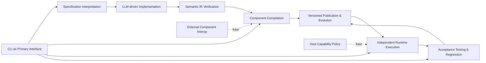

> Idioma del proyecto: **español**. Escribe este conocimiento en español. Mantén en inglés el código, los nombres de archivo, los comandos y las claves de configuración.

# Capabilities

Generado a partir del Context Pack de Kaddo y de `knowledge/product/product.md`. El proyecto está en estado `new`: se definen capacidades **planeadas**, no inventario de lo existente. La POC en `_reference/poc-agent-native/` es evidencia histórica, no evidencia del producto nuevo.

## Summary

Agent-Native agrupa sus capacidades en cinco responsabilidades que deben operar de forma separada pero integrada: **Specification**, **Implementation**, **Compilation**, **Runtime** y **Validation & Evolution**. Cada responsabilidad se declara aquí como una capacidad planeada con alcance mínimo verificable (MVP) y evolución diferida; todas comparten dos invariantes de producto: la IA interviene únicamente durante el build y los componentes publicados conservan comportamiento sin el agente que los generó.

## Capability Map

### Specification Interpretation

**Description:** Interpretar narrativas Markdown, reglas de negocio, contratos WIT y Work Items incrementales en una `System Spec` estructurada, trazable al requisito de origen.

**Evidence:** - pending validation (producto nuevo, estado `[planned]`).

**Related folders or modules:** `crates/ir` (futuro), orquestador de ingestión; integración opcional con Kaddo para Work Items.

**Possible domain:** Specification & Knowledge Ingestion.

**Confidence:** Medium — alcance recuperable de la POC, pero la API pública del `System Spec` aún no está decidida (ver `codebase.md` L143).

**Open questions:**
- [open] ¿Qué partes del modelo `System Spec` se exponen como contrato público y versionado?

**Candidate ownership:** Equipo de IR/orquestación.

**Suggested code globs:** `crates/ir/src/spec/**/*.rs`

---

### LLM-driven Implementation

**Description:** Generar Semantic IR v0.5 asistida por LLM a partir de la `System Spec`, con diagnósticos explícitos y sin fallback silencioso al sintetizador determinista. La generación ocurre solo durante el build.

**Evidence:** - pending validation.

**Related folders or modules:** `crates/compiler` (agente de implementación), adaptador de proveedor LLM.

**Possible domain:** Implementation.

**Confidence:** Medium — comportamiento recuperable de la POC; depende de un contrato estable de IR.

**Open questions:**
- [open] ¿Cómo se separa el modo "LLM real" del "sintetizador determinista" en pruebas offline sin ocultar fallas del proveedor?

**Candidate ownership:** Equipo de compilador/IR.

**Suggested code globs:** `crates/compiler/src/implementation/**/*.rs`

---

### Semantic IR Verification

**Description:** Validar tipos, operaciones, imports y efectos de la Semantic IR antes de compilar. Reportar diagnósticos localizados y rechazar IR inválida sin generar WASM.

**Evidence:** - pending validation.

**Related folders or modules:** `crates/ir` (verificador), `crates/compiler` (interfaz de rechazo).

**Possible domain:** Implementation.

**Confidence:** High — la POC demostró viabilidad; el alcance mínimo está acotado por la gramática v0.5.

**Open questions:**
- [open] ¿Qué extensiones de IR (string, streams, efectos secuenciados, errores) se versionan como contratos estables? (ver `codebase.md` L144)

**Candidate ownership:** Equipo de IR.

**Suggested code globs:** `crates/ir/src/verifier/**/*.rs`

---

### Component Compilation

**Description:** Transformar Semantic IR verificada en WASM Component Model con contratos WIT, metadatos y hashes SHA-256 reproducibles.

**Evidence:** - pending validation.

**Related folders or modules:** `crates/compiler` (backend WASM), herramientas `wit-bindgen`/`wasm-tools`.

**Possible domain:** Compilation.

**Confidence:** High — el camino técnico ya se validó en la POC; falta formalizar baseline de Wasmtime/WIT/WASI.

**Open questions:**
- [open] ¿Qué versión de Wasmtime, WIT y WASI es la baseline soportada? (ver `codebase.md` L145)

**Candidate ownership:** Equipo de compilador.

**Suggested code globs:** `crates/compiler/src/wasm/**/*.rs`, `wit/**/*.wit`

---

### Independent Runtime Execution

**Description:** Ejecutar componentes publicados sin invocar IA ni Cargo, con resolución controlada de dependencias y acceso autorizado a capacidades del host.

**Evidence:** - pending validation.

**Related folders or modules:** `crates/runtime` (ejecutor Wasmtime, loader de manifiestos), `cli` (comando `run`).

**Possible domain:** Runtime.

**Confidence:** Medium — el runtime autónomo es nueva superficie; la POC solo ejecutó dentro de la toolchain Rust.

**Open questions:**
- [open] ¿Cómo se implementa el caché de componentes y el ciclo de vida de instancias sin fuga de memoria ni estado compartido entre tenants? (ver `codebase.md` L146)
- [open] ¿Cómo se reemplaza la compilación/instanciación repetida de dependencias de la POC por un resolver reutilizable? (ver `codebase.md` L147)

**Candidate ownership:** Equipo de runtime.

**Suggested code globs:** `crates/runtime/src/**/*.rs`

---

### Acceptance Testing & Regression

**Description:** Ejecutar suites de aceptación declaradas en YAML (entradas, resultados esperados, llamadas de host simuladas) y pruebas de regresión sobre versiones publicadas; informar aprobados, fallidos y evidencia verificable sin requerir el proveedor LLM.

**Evidence:** - pending validation.

**Related folders or modules:** `crates/runtime` (test runner), fixtures de dominio en `tests/`.

**Possible domain:** Validation & Evolution.

**Confidence:** High — el formato YAML y la ejecución determinista se recuperan directamente de la POC.

**Open questions:**
- [open] ¿Qué capacidades de consola/WASI se simulan primero y cómo se declara su stub? (ver `codebase.md` L152)

**Candidate ownership:** Equipo de runtime/QA.

**Suggested code globs:** `crates/runtime/src/testing/**/*.rs`, `tests/acceptance/**/*.yaml`

---

### Versioned Publication & Evolution

**Description:** Publicar artefactos WASM de forma atómica con metadatos, hashes y puntero activo; preservar la versión anterior ante fallo; reconciliar un nuevo Work Item con la versión previa (v1 → v2) sin sobrescribir publicaciones aprobadas.

**Evidence:** - pending validation.

**Related folders or modules:** store de artefactos (futuro `crates/compiler/publish`), metadatos JSON.

**Possible domain:** Validation & Evolution.

**Confidence:** High — la POC validó la evolución v1 → v2 en el dominio de esclusas.

**Open questions:**
- [open] ¿El store de artefactos es filesystem local, OCI o ambos en MVP?

**Candidate ownership:** Equipo de orquestador/compilador.

**Suggested code globs:** `crates/compiler/src/publish/**/*.rs`

---

### CLI as Primary Interface

**Description:** Exponer `build`, `verify`, `run`, `test` y `publish` desde un binario autónomo distribuido como tarball firmado para Linux x86_64, Windows x86_64 y macOS arm64; sin requerir toolchain Rust en el entorno de destino.

**Evidence:** - pending validation.

**Related folders or modules:** `crates/cli` (bin), scripts de release (`.github/workflows/release.yml` futuro).

**Possible domain:** Distribution & DX.

**Confidence:** Medium — alcance de distribución asumido (ver `codebase.md` L151 `[assumed]`).

**Open questions:**
- [open] ¿Qué subcomandos quedan ocultos tras `--experimental` en el primer release?

**Candidate ownership:** Equipo de CLI.

**Suggested code globs:** `crates/cli/src/**/*.rs`

---

### Host Capability Policy (futuro)

**Description:** Declarar y aplicar permisos de capacidades de host (consola, filesystem, HTTP, KV, mensajería) con límites de recursos, aislamiento de estado y, posteriormente, firma y procedencia de componentes.

**Evidence:** - pending validation; capacidad diferida respecto al MVP.

**Related folders or modules:** `crates/runtime/src/host_policy/**/*.rs` (futuro).

**Possible domain:** Runtime Security.

**Confidence:** Low — superficie nueva, sin equivalente directo en la POC.

**Open questions:**
- [open] ¿Qué modelo de permisos, límites y procedencia se exige antes de habilitar I/O real o multiusuario? (ver `codebase.md` L149)

**Candidate ownership:** Equipo de runtime + seguridad.

**Suggested code globs:** `crates/runtime/src/host_policy/**/*.rs`

---

### External Component Interop (futuro)

**Description:** Registrar y resolver WASM Components externos (p. ej. librerías compiladas desde otros lenguajes) con contratos WIT compatibles, composición de dependencias y versionamiento verificable.

**Evidence:** - pending validation; capacidad diferida respecto al MVP.

**Related folders or modules:** registro de componentes (futuro), resolver WIT.

**Possible domain:** Compilation / Runtime.

**Confidence:** Low — la POC solo compuso componentes propios.

**Open questions:**
- [open] ¿Cómo se versionan contratos WIT compartidos y qué política de compatibilidad se aplica? (ver `codebase.md` L150)

**Candidate ownership:** Equipo de compilador/runtime.

**Suggested code globs:** `crates/compiler/src/compose/**/*.rs`

---

## Cross-cutting Concerns

- **Trazabilidad end-to-end:** Work Item → `System Spec` → IR → WASM → publicación → evidencia de aceptación. Cada etapa debe producir metadatos referenciables desde Kaddo.
- **Determinismo offline:** las pruebas de regresión no deben depender del proveedor LLM; el modo real queda bajo secretos.
- **Fallos explícitos:** cualquier capacidad del host no autorizada, dependencia faltante o contrato violado produce error, nunca un resultado válido inventado.
- **Separación de responsabilidades:** compilador no depende de runtime; runtime no depende de LLM ni Kaddo; CLI no concentra lógica de dominio.

## Risks

- Expansión prematura de Semantic IR hacia `string`, streams o errores sin suite de regresión equivalente a la POC.
- Fuga de estado entre instancias persistentes o entre tenants por elección temprana de allocator o caché.
- Dependencia implícita de una versión concreta de Wasmtime/WIT/WASI sin matriz de compatibilidad verificada.
- Distribución de binarios sin firma ni verificación de integridad.
- Pérdida de equivalencia funcional al retirar `_reference/poc-agent-native/` antes de recuperar las 27 pruebas registradas y los dominios v1/v2.

## Open Questions

- [open] ¿Qué subset de capacidades aquí listadas forma el MVP publicable del nuevo repositorio y cuáles quedan como roadmap posterior?
- [open] ¿La integración con Kaddo se declara capacidad opcional o solo integración de workflow?
- [open] ¿Qué métricas mínimas (latencia, memoria, throughput) definen "listo para release" por capacidad, una vez medida la línea base?

## Suggested Next Step

Ejecutar `roadmap-agent` sobre este archivo + `knowledge/product/product.md` para proponer Work Items priorizados a partir de las capacidades `[planned]` y materializarlos con `kaddo create --from roadmap`.

## Diagrams

────────────────────────
Agent: capability-agent

Produced:
knowledge/product/capabilities.md

Next:
roadmap-agent
────────────────────────
