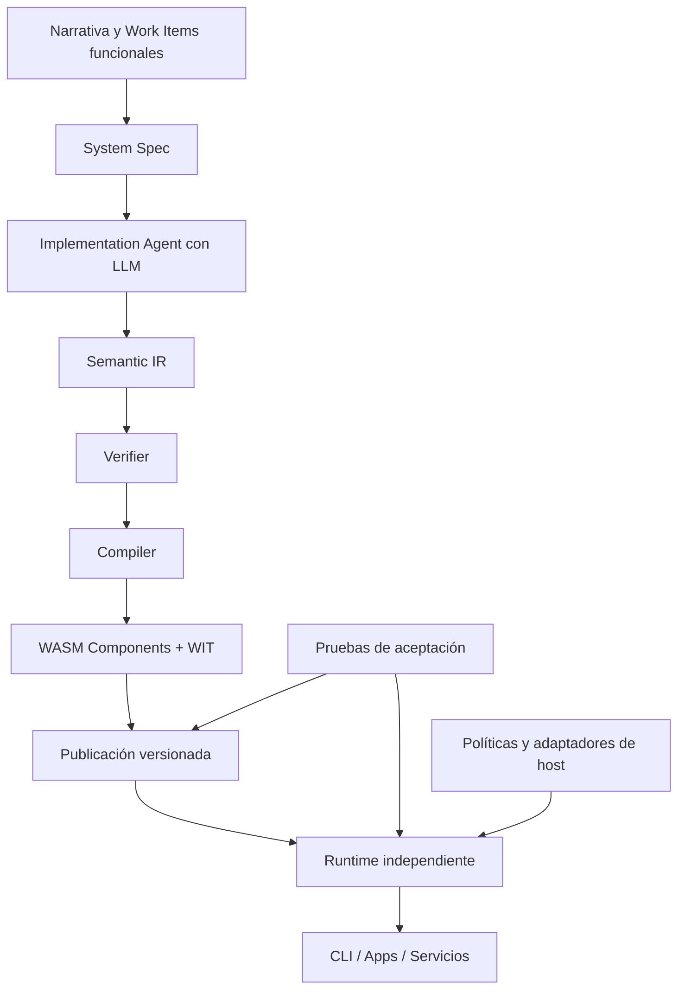

> Idioma del proyecto: **español**. Escribe este conocimiento en español. Mantén en inglés el código, los nombres de archivo, los comandos y las claves de configuración.

# Product Context

## Product vision

**Agent-Native** será un sistema open source para **convertir especificaciones funcionales y cambios incrementales en componentes de software ejecutables**, utilizando IA para proponer implementaciones, una representación intermedia semántica verificable para expresar su comportamiento y WebAssembly Component Model para compilarlos y ejecutarlos mediante contratos explícitos.

Su propuesta combina cinco capacidades que deben funcionar de forma separada pero integrada:

1. **Specification:** interpretación de narrativas, reglas, contratos y cambios incrementales en una especificación estructurada del sistema.
2. **Implementation:** generación asistida por LLM de Semantic IR; validación y diagnósticos, sin depender de comportamientos codificados para dominios específicos.
3. **Compilation:** transformación de Semantic IR verificada en artefactos WASM interoperables mediante WIT, con versiones y metadatos trazables.
4. **Runtime:** ejecución de los componentes publicados sin invocar IA, resolución controlada de dependencias y acceso autorizado a capacidades externas.
5. **Validation & Evolution:** pruebas de aceptación, regresión, evidencia de resultados, preservación de versiones y evolución mediante nuevos requisitos.

**Principio de diseño:** la IA propone código; el verificador, el compilador, las pruebas y las políticas de ejecución establecen lo que puede publicarse y ejecutarse. Un componente compilado debe conservar su comportamiento operativo sin necesitar el agente que lo generó.

**Estado del producto:** el repositorio [`Kaddo-kdd/agent-native`](https://github.com/Kaddo-kdd/agent-native) se encuentra en fase de inicio (verificado el 17 de octubre de 2026, con `LICENSE` como único archivo remoto). La implementación y pruebas existentes están en la **POC de referencia**, no todavía en este producto. El alcance descrito aquí es la visión y el plan incremental, no una lista de funcionalidades ya disponibles en el nuevo repositorio.

## User journeys

### Journey 1 — Describir y construir una capacidad

Un desarrollador define una narrativa funcional, reglas de negocio, entradas/salidas y contratos WIT. Agent-Native interpreta ese material como `System Spec`, solicita al agente de implementación una Semantic IR válida, verifica tipos y operaciones, compila WASM y registra el artefacto con evidencia y metadatos. Si una etapa falla, devuelve diagnósticos explícitos y no publica un componente como exitoso. La generación con LLM se realiza durante el build, no durante cada invocación posterior.

### Journey 2 — Verificar el comportamiento

El desarrollador ejecuta una suite de aceptación con entradas, resultados esperados y, cuando corresponda, llamadas de host simuladas. El sistema informa casos aprobados y fallidos, errores de contrato o dependencia y evidencia verificable. La ejecución de pruebas puede ser determinista y sin conexión al proveedor LLM cuando los artefactos ya están disponibles.

### Journey 3 — Evolucionar el software mediante requisitos

Se incorpora un nuevo Work Item funcional que modifica una regla. Agent-Native reconcilia la nueva especificación con la versión anterior, genera artefactos nuevos y ejecuta pruebas de regresión. El cambio no sobrescribe artefactos publicados: una nueva versión se activa únicamente cuando supera los criterios definidos y la publicación es consistente. La POC validó una evolución incremental v1 → v2; el nuevo producto deberá recuperar esa garantía.

### Journey 4 — Ejecutar componentes desde una aplicación o CLI

Una persona o aplicación selecciona un componente publicado, proporciona parámetros y recibe un resultado sin depender de Cargo ni del LLM. En una etapa posterior, un runtime persistente podrá exponer funciones mediante CLI, SDK o adaptadores HTTP. El host aplica permisos, límites y resolución de dependencias antes de realizar operaciones externas.

### Journey 5 — Reutilizar funcionalidades existentes

Un desarrollador dispone de una librería convertida a un **WASM Component** compatible con WIT. El sistema deberá permitir registrarla, verificar su contrato y utilizar sus funciones desde componentes generados por Agent-Native. Esta interoperabilidad general es una **capacidad futura**: no implica que cualquier paquete npm, Python, Go o C++ sea compatible sin recompilación o adaptación.

### Journey 6 — Crear herramientas interactivas

En una etapa posterior, se podrán generar programas CLI capaces de leer valores e imprimir resultados mediante capacidades autorizadas de consola o interfaces WASI. Esto requerirá ampliar el soporte de tipos (por ejemplo, `string`), secuenciación de efectos e interacción con I/O. No forma parte del núcleo validado de Semantic IR v0.5.

## Scope

### Capacidad base que se recuperará de la POC

- Interpretación de narrativas Markdown y Work Items incrementales en `System Spec`.
- Semantic IR v0.5 con operaciones numéricas, booleanas, registros, aritmética, comparaciones, condicionales, llamadas e imports soportados por la gramática existente.
- Verificación de Semantic IR, compilación a WebAssembly Component Model y contratos WIT.
- Generación real por LLM con diagnósticos y sin fallback silencioso al sintetizador determinista.
- Ejecución dinámica de componentes mediante Wasmtime, composición WIT dentro de los límites conocidos y pruebas de aceptación en YAML.
- Propagación explícita de errores de dependencias y capacidades de host no registradas.
- Artefactos versionados, metadatos, hashes SHA-256, publicación atómica y recuperación ante fallos parciales.
- Recuperación de los escenarios y pruebas verificadas en la POC, incluyendo el dominio de esclusas v1/v2.

La migración solo se considerará completada cuando estas capacidades funcionen en el **nuevo repositorio** sin consultar código ejecutable dentro de `_reference/`.

### Evolución prevista, posterior a la recuperación funcional

- **Runtime independiente:** comandos de ejecución y, posteriormente, servicio persistente; carga por manifiesto, caché de componentes y ciclo de vida explícito de instancias.
- **Seguridad de ejecución:** límites configurables de recursos, políticas de capacidades con privilegio mínimo, aislamiento de estado, validación de integridad y eventual firma/procedencia.
- **I/O controlado:** consola (`stdin`, `stdout`, `stderr`) y adaptadores de host mediante WIT/WASI. HTTP, filesystem, KV, bases de datos y mensajería se incorporarán de manera gradual y con permisos definidos.
- **Interoperabilidad:** registro y resolución de componentes externos con contratos/versiones compatibles; ampliar composición más allá de un enlace individual.
- **Calidad y desempeño:** benchmarks separados de generación y runtime; métricas de cold/warm start, latencia p50/p95/p99, throughput, memoria, soak tests y fallos por recursos.
- **Concurrencia:** paralelización desde el host, workers e instancias aisladas, antes de evaluar primitivas asíncronas dentro de una futura versión de Semantic IR.
- **Distribución:** binarios y documentación de uso sin toolchain Rust en el entorno de destino, según plataformas verificadas.
- **Integraciones:** SDKs y adaptadores para web, desktop, backend y edge según necesidades reales. La lógica WASM podrá integrarse en esos entornos; la generación de toda la interfaz de usuario no es un compromiso de la primera etapa.

### Fuera del alcance inicial

- Generar aplicaciones completas con UI, frontend React, escritorio, base de datos e infraestructura sin desarrollo adicional.
- Replicar funcionalidades arbitrarias de cualquier lenguaje, como las goroutines completas de Go, sin soporte explícito de la IR y del runtime.
- Ejecutar sin adaptación cualquier librería compilada a WASM Core: la interoperabilidad del producto se basará en componentes e interfaces compatibles.
- Otorgar permisos irrestrictos de red, archivos, procesos o secretos a código generado por IA.
- Ejecutar un LLM en cada solicitud del runtime.
- Exigir Kaddo como dependencia a usuarios de Agent-Native; una integración posterior podrá ser opcional.
- Prometer que WASM siempre es más rápido o consume menos memoria que implementaciones nativas o de otros runtimes.

## Success criteria

### Criterios de salida de la etapa de extracción

1. **Autonomía:** el nuevo repositorio compila y ejecuta sin utilizar fuentes de `_reference/poc-agent-native/`; la referencia puede retirarse sin romper el producto.
2. **Equivalencia funcional:** se recuperan las pruebas pertinentes de `irtool`, `orchestrator` y `runner` (27 registradas en la POC) y las suites del dominio desconocido v1/v2 (5/5 y 5/5 en la evidencia histórica), o se justifican explícitamente sus reemplazos. Estas cifras son línea base histórica, no resultados todavía obtenidos en Agent-Native.
3. **Generalización:** una construcción con LLM real en un dominio no preprogramado produce IR válida, WASM ejecutable y resultados de aceptación correctos. El sintetizador de ejemplos no puede reemplazar ese criterio.
4. **Integridad y evolución:** versiones publicadas inmutables, puntero activo consistente, integridad SHA-256 y preservación de la versión anterior cuando falla una publicación.
5. **Fallos seguros:** dependencias faltantes, operaciones del host no autorizadas y errores de contrato generan fallos explícitos; jamás resultados válidos inventados como `0` o `false`.
6. **Separación de responsabilidades:** el compilador no depende del runtime; el runtime no necesita LLM ni Kaddo; el CLI es una interfaz y no concentra toda la lógica del sistema.
7. **Operación y mantenibilidad:** instrucciones reproducibles, pruebas automáticas, estructura documentada y decisiones arquitectónicas registradas.

### Criterios de etapas posteriores

- **CLI standalone:** ejecutar componentes en una instalación destino sin `cargo run` ni un proveedor LLM.
- **Seguridad:** política explícita de capacidades y límites de recursos comprobada mediante pruebas negativas y de estrés.
- **Consola:** entrada/salida funcional, automatizable y con errores explícitos; permisos de consola deshabilitables.
- **Rendimiento:** resultados reproducibles de latencia, memoria y throughput; comparación justa con implementaciones equivalentes. Los umbrales de aceptación se fijarán después de medir la línea base, no se inventarán previamente.
- **Portabilidad:** matriz de sistemas operativos, arquitecturas, versiones WASI y compatibilidad WIT mantenida con pruebas verificables.

## Diagrams

Las conexiones entre requisitos, IR, compilación, Wasmtime y publicación se basan en la POC. Las políticas completas, la distribución como runtime autónomo y los adaptadores generales son objetivos de producto sujetos a implementación y verificación.
