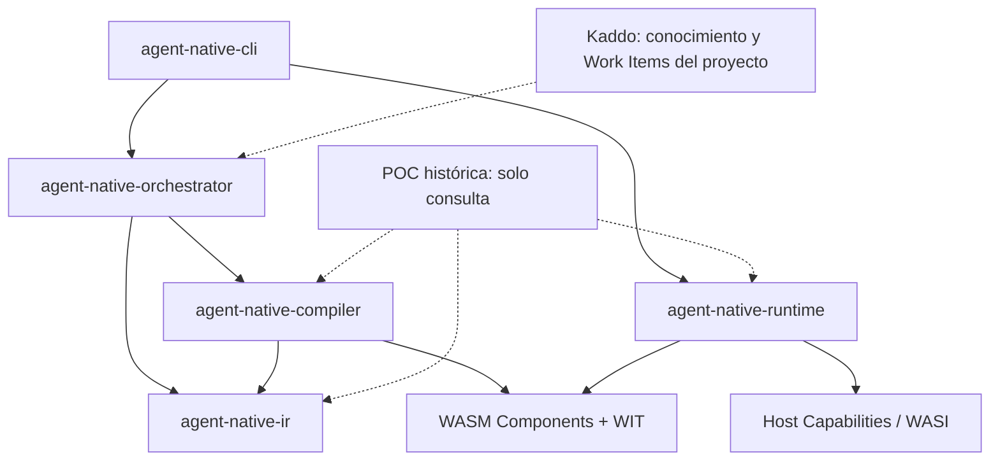

> Idioma del proyecto: **español**. Escribe este conocimiento en español. Mantén en inglés el código, los nombres de archivo, los comandos y las claves de configuración.

# Codebase Map

## Repository structure

### Estado actual verificado

El repositorio destino es [`Kaddo-kdd/agent-native`](https://github.com/Kaddo-kdd/agent-native). Al 17 de octubre de 2026, la rama remota `main` contiene únicamente `LICENSE` (MIT). **No se ha verificado todavía código de producción, workspace Rust, CLI ni pruebas dentro del repositorio nuevo.** La copia local, una vez inicializada con Kaddo, puede incorporar archivos adicionales que no aparezcan aún en GitHub.

La implementación de referencia se encuentra en [`Trycatch-tv/poc-agent-native`](https://github.com/Trycatch-tv/poc-agent-native), con la línea base de extracción fijada en el commit `26b6a18e2f4a50086d5ee604051154d9ea77d768`. Los reportes históricos de la POC describen 27 pruebas de workspace y las suites de aceptación del caso de esclusas v1/v2; esta evidencia **no constituye ejecución de pruebas del nuevo repositorio**.

### Estructura objetivo provisional

La organización física y los nombres de crates están **propuestos, no implementados ni aprobados definitivamente**. Deben revisarse en el Work Item de arquitectura `AN-001` antes de crear módulos vacíos.

```text
agent-native/
├── .gitignore
├── .kaddo/                         # Configuración y contexto derivado por Kaddo
├── knowledge/
│   ├── business/
│   ├── product/
│   ├── tech/
│   └── delivery/
│       └── work-items/
├── crates/
│   ├── agent-native-ir/             # Modelo y verificación semántica
│   ├── agent-native-compiler/       # Semantic IR -> WebAssembly Component
│   ├── agent-native-orchestrator/   # Spec, agente LLM, evolución y publicación
│   ├── agent-native-runtime/        # Carga, composición, sandbox, host capabilities
│   └── agent-native-cli/            # Interfaces spec/build/test/run
├── wit/                             # Interfaces WIT del producto y fixtures
├── tests/                           # Integración, regresión y E2E
├── examples/                        # Casos de uso independientes
├── docs/                            # Arquitectura, contratos y decisiones publicadas
├── Cargo.toml                       # Workspace cuando comience la implementación
├── Cargo.lock                       # Lockfile del producto cuando aplique
├── LICENSE
└── _reference/
    └── poc-agent-native/            # Clone histórico, solo lectura, ignorado (ver reference-policy.md)
```

**Principio de diseño:** comenzar extrayendo capacidades completas y comprobables. El número final de crates puede ser menor si se demuestra que la separación anterior introduce complejidad innecesaria; los límites lógicos deben mantenerse aunque se consoliden paquetes.

### Mapa de extracción desde la POC

| Fuente histórica (solo consulta) | Responsabilidad validada | Destino conceptual / tratamiento |
| --- | --- | --- |
| `crates/irtool/src/lib.rs` | Verificación de Semantic IR, validación de contratos y compilación | Separar IR/verifier de compiler si los límites lo justifican; conservar pruebas |
| `crates/orchestrator/src/interpreter.rs` | Narrativa Markdown → `System Spec` | Módulo de especificaciones, desacoplado del runtime |
| `crates/orchestrator/src/agent.rs` | Generación con LLM y diagnósticos | Adaptador de proveedor LLM con interfaz explícita y modo estricto |
| `crates/orchestrator/src/lib.rs` | Build, evolución, manifiestos e integridad/publicación | Orquestación y almacenamiento de artefactos; preservar publicación atómica |
| `crates/runner/src/main.rs` | Wasmtime, composición dinámica, host capabilities, pruebas YAML | Separar biblioteca de runtime del ejecutor de pruebas y de la CLI |
| `wit/` | Contratos de componentes | Contratos y fixtures clasificados; no imponer dominios de demostración al núcleo |
| `runs/unknown-domain-e2e/` | Escenario LLM real y evolución v1/v2 | Suite E2E reproducible, artefactos de referencia y evidencia histórica |
| `BENCHMARK_REPORT_005.md` y `RELEASE_CANDIDATE_v0.1.0.md` | Evidencia, limitaciones y garantías del cierre de POC | Fuentes de trazabilidad; no convertir automáticamente sus cifras en SLAs de producto |

El paquete de ejemplo `kaddo:canal@0.1.0` corresponde a un **fixture de prueba**, no a una dependencia de dominio ni a una obligación de integrar Kaddo en el runtime.

Las reglas de uso de `_reference/poc-agent-native/` (solo lectura, prohibición de dependencias técnicas, consulta autorizada por agentes y procedimientos de verificación) están definidas en [reference-policy.md](reference-policy.md) — vinculada al WI AN-001.

### Límites y dependencias deseadas

- `agent-native-ir` define estructuras, gramática y verificación; no depende del LLM, del runtime ni de Kaddo.
- `agent-native-compiler` consume una IR válida y produce WASM/WIT; no invoca ejecución de negocio.
- `agent-native-orchestrator` coordina especificación, proveedor LLM, verificación, compilación y publicación; utiliza abstracciones explícitas para persistencia y generación.
- `agent-native-runtime` consume WASM, manifiestos y contratos, resuelve dependencias y ejecuta imports autorizados; **no depende de agentes LLM ni de Kaddo**.
- `agent-native-cli` ofrece comandos de usuario sobre APIs reutilizables; las suites automatizadas no deben depender de analizar su salida textual.
- `tests/` y `examples/` ejercitan contratos públicos y componentes externos, no rutas privadas de `_reference/`.

La validación de Semantic IR, la autorización de capacidades y la aprobación funcional son controles diferentes y no deben mezclarse. Un componente que pasa el verificador todavía puede ser incorrecto funcionalmente o requerir permisos que el host deba denegar.

## Entry points

### Existentes en la POC (históricos)

- `crates/orchestrator/src/main.rs`: CLI `orchestrator` para interpretación, construcción y evolución de especificaciones.
- `crates/irtool/src/main.rs`: utilidad de verificación/compilación de Semantic IR.
- `crates/runner/src/main.rs`: CLI `runner test` para ejecutar suites YAML sobre componentes WASM.
- `crates/*/src/lib.rs`: lógica reutilizable en los crates que la exponen, con separación parcial según la POC.

### Propuestos para Agent-Native

- **CLI pública:** `agent-native spec`, `agent-native build`, `agent-native test` y `agent-native run`; las opciones exactas se definirán mediante WIs y pruebas de contrato. No existen aún en el repositorio nuevo.
- **APIs de biblioteca:** verificación/compilación de IR, construcción de artefactos, carga/ejecución de componentes y pruebas de aceptación; deben usarse desde el CLI, el test harness y futuros adaptadores.
- **Servicio persistente futuro:** `agent-native serve`, únicamente después de asegurar límites de ejecución, estado, aislamiento y políticas de capacidades.
- **Conectores posteriores:** CLI interactiva/WASI, HTTP, aplicaciones web/desktop, SDKs y librerías WASM externas compatibles con WIT.

## How to run

### Preparación del repositorio nuevo (comandos disponibles o dependientes de instalación)

El flujo de inicio planificado es clonar `Kaddo-kdd/agent-native`, crear una entrada de `.gitignore` para `/_reference/poc-agent-native/`, clonar la POC allí y fijarla en el commit `26b6a18e2f4a50086d5ee604051154d9ea77d768`. Se debe evitar introducir el subrepositorio o su carpeta `.git` en el repositorio destino. Verificar localmente mediante:

```bash
git check-ignore -v _reference/poc-agent-native/Cargo.toml
git status --short
```

La exclusión por `.gitignore` **no excluye automáticamente** esa carpeta de las lecturas de agentes, IDEs o herramientas de indexación: las instrucciones y los Work Items deben tratar `_reference/` como fuente histórica de solo lectura. No se modificará ni se hará commit en la POC desde el flujo de migración.

Para iniciar Kaddo en modo `new`, usar `npx @kaddo/cli init` y, una vez disponible el comando `kaddo` en el entorno: `kaddo bootstrap`, `kaddo add agents`, `kaddo add skills`, `kaddo context` y `kaddo understand`. Este conocimiento no debe poblarse copiando `.kaddo/` ni `knowledge/` de la POC.

### Ejecución del producto (pendiente)

Todavía no hay una CLI independiente verificada en `agent-native`. Al completar la extracción, el flujo de desarrollo debería permitir `cargo build --workspace --release` y la ejecución directa de los binarios generados. La experiencia de distribución deberá permitir utilizar `agent-native` **sin Rust, Cargo ni acceso al LLM** para componentes que ya fueron compilados. Los comandos públicos concretos se confirmarán en sus Work Items; no deben anunciarse como implementados antes de probarlos.

## How to test

### Línea base histórica

La POC documenta `cargo test --workspace` con 27 pruebas: `irtool` (8), `orchestrator` (9) y `runner` (10). Incluye el dominio desconocido de control de esclusas, con cinco casos de aceptación en v1 y cinco en v2, y pruebas de errores de dependencias y capacidades de host. Estas cifras corresponden a la referencia y deben reproducirse o sustituirse por equivalentes justificados.

### Estrategia del nuevo repositorio

- **Unitarias:** verificador de Semantic IR, inferencia de tipos, generación de WASM, semántica de errores y políticas de capacidades.
- **Contrato:** compatibilidad de WIT/componentes, imports/exports, retornos y versiones de interfaz.
- **Integración:** compilador → componente → runtime; resolución de dependencias; publicación, activación, integridad y recuperación ante fallos.
- **E2E:** narrativa/Work Item → generación real con LLM → IR → WASM → aceptación, en dominios no codificados previamente en el motor.
- **Regresión offline:** fixtures y componentes previamente generados; ejecución reproducible en CI sin credenciales de LLM.
- **Seguridad:** denegación explícita de host capabilities, traps, validación de inputs, aislamiento, presupuestos de memoria/CPU y binarios alterados; los controles aún inexistentes deben llegar mediante WIs propios.
- **Desempeño:** separar generación/compilación de ejecución. Medir cold start, warm invocation, dependencias enlazadas, latencias p50/p95/p99, throughput, memoria y estabilidad bajo carga. No inferir desempeño a partir de tiempos de suites de cinco pruebas.

**Comandos de CI objetivo**, disponibles únicamente después de crear el workspace Rust del producto:

```bash
cargo fmt --all -- --check
cargo clippy --workspace --all-targets -- -D warnings
cargo test --workspace
```

Para pruebas con un proveedor LLM real, utilizar ejecución manual o un job controlado por secretos; no exigir claves del proveedor para ejecutar las regresiones offline del proyecto. No introducir artefactos de build, claves ni credenciales en Git.

## Open questions

- [assumed] ¿Mantener cinco crates propuestos o comenzar con menos módulos y extraer responsabilidades a medida que crece la API estable?
  - note: Para el MVP arrancamos con 3 crates (`ir`, `compiler`, `runtime`) + un bin `cli`; `orchestrator` se extrae cuando la API de IR y runtime estén estables.
- [open] ¿Qué parte del modelo de `System Spec` y del contrato Semantic IR v0.5 debe ser pública y versionarse como interfaz estable?
- [open] ¿Cuál será la estrategia de evolución de Semantic IR para `string`, streams, secuenciación de efectos, errores y estructuras de datos adicionales?
- [open] ¿Qué versión de Wasmtime, WIT y WASI se adoptará como baseline soportado? No realizar una actualización de runtime sin pruebas de compatibilidad y regresión.
- [open] ¿Cómo se implementarán el caché de componentes y el ciclo de vida de instancias sin fuga de memoria ni estado entre solicitudes o tenants?
- [open] ¿Cómo reemplazar la compilación/instanciación repetida de dependencias que realiza el runner de la POC por un resolver reutilizable y seguro?
- [deferred] ¿Qué allocator/estrategia de memoria utilizarán los componentes generados que devuelven registros, especialmente con instancias persistentes?
  - note: El supuesto previo (dlmalloc + copia al host + reset entre tenants) fue retirado por falta de sustento técnico. La POC usa un asignador incremental sin estrategia general de liberación — se registra como riesgo R-11. Diferida hasta INIT-02-05 (modelo de memoria y Canonical ABI) + ADR-005; no asumir instancias persistentes reutilizables entre tenants sin garantías de aislamiento verificables (INIT-06-03). No bloquea el inicio del roadmap.
- [open] ¿Qué modelo de permisos, límites de recursos, procedencia y firma se exigirá antes de permitir I/O real o ejecución multiusuario?
- [open] ¿Cómo se manejarán imports externos, múltiples dependencias, versionamiento de contratos y librerías de otros lenguajes compiladas al Component Model?
- [assumed] ¿Qué plataformas, arquitecturas y formatos de distribución se incluirán en el primer release autónomo?
  - note: Primer release: binarios estáticos de la CLI para `x86_64-unknown-linux-gnu`, `x86_64-pc-windows-msvc` y `aarch64-apple-darwin`, distribuidos como tarball/zip firmado desde GitHub Releases. Imagen OCI y paquetes nativos quedan diferidos.
- [open] ¿Qué capacidades estándar de consola/WASI se habilitarán primero y cómo se simularán `stdin`, `stdout` y `stderr` durante pruebas?
- [open] ¿Qué umbrales de rendimiento se establecerán una vez medida la línea base, sin adelantar afirmaciones de superioridad frente a Rust, Go o TypeScript?
- [open] ¿Qué artefactos de conocimiento, pruebas y evidencia de la POC se migrarán como fuentes trazables, y cuáles deben permanecer únicamente en `_reference/`?

## Diagrams



Las líneas continuas expresan **dependencias propuestas del producto**, sujetas a aprobación arquitectónica. Las líneas punteadas representan relaciones de proceso o consulta, **no dependencias en tiempo de ejecución**. Kaddo es la herramienta de gestión del desarrollo del proyecto; los componentes del producto no deben depender de su runtime.
